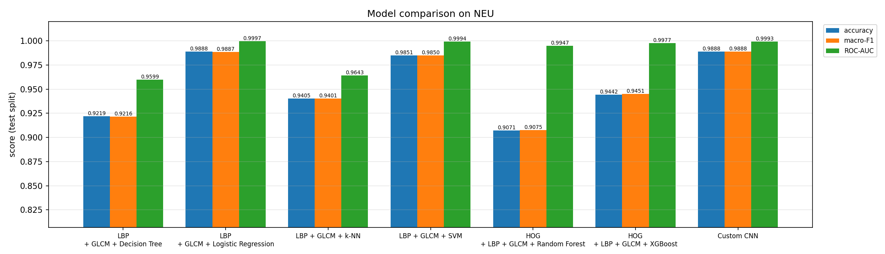
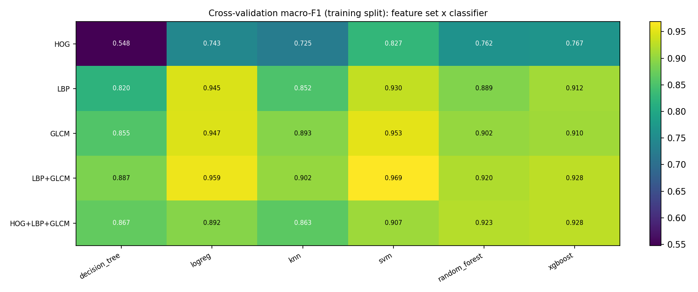
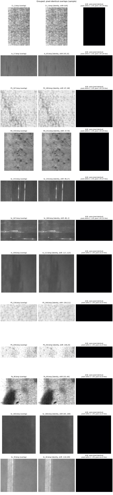
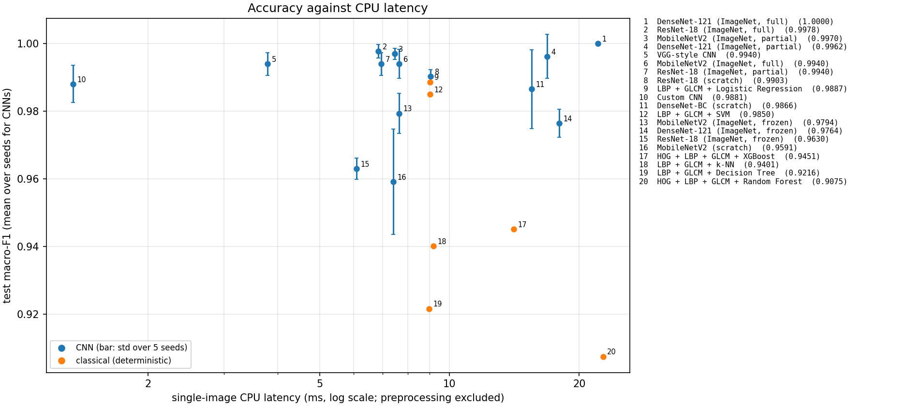
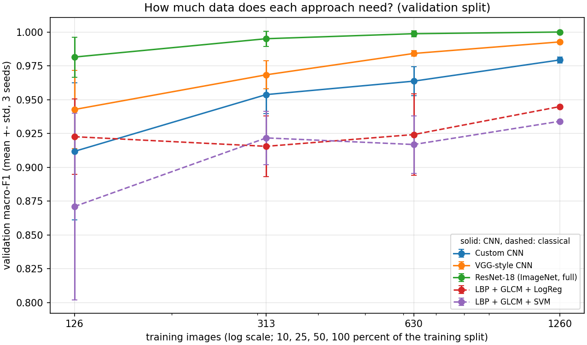
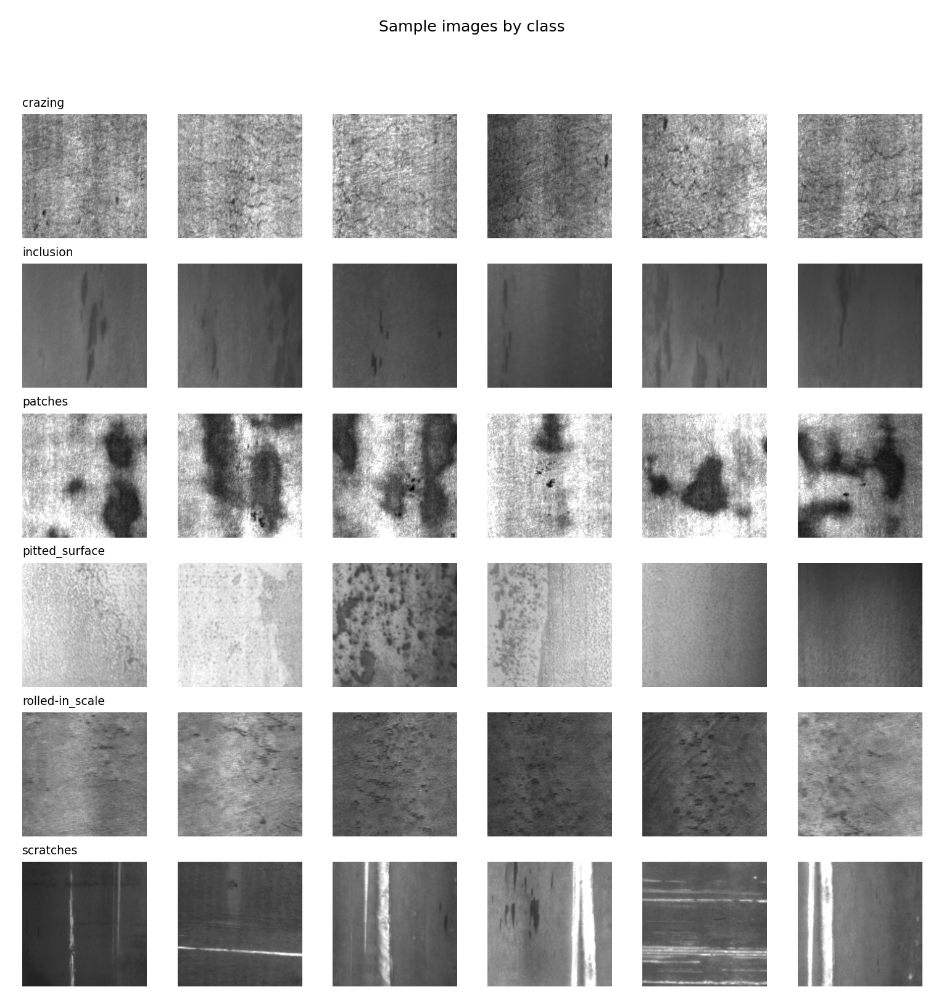

# Automated Industrial Surface Defect Analysis

**Classical computer vision and machine learning versus CNN-based deep learning for steel-surface defect classification.**

A modular, reproducible computer-vision project that classifies hot-rolled
steel-strip surface defects from the
[NEU Surface Defect Database](https://faculty.neu.edu.cn/songkc/en/zdylm/263265).
It studies the problem through a deliberate progression: classical image
processing and handcrafted features, then classical machine learning, then
CNN-based deep learning, with every model evaluated on the same data split.

The guiding rule is that every technique must answer a question. No algorithm
is included merely because it is advanced or popular.

## Results on NEU

<!-- RESULTS:START -->
| Model | Accuracy | Macro P | Macro R | Macro F1 | ROC-AUC (OvR) | Macro F1 spread | Size |
|---|---|---|---|---|---|---|---|
| LBP + GLCM + Decision Tree | 0.9219 | 0.9239 | 0.9214 | 0.9216 | 0.9599 | 0.8867 +- 0.0461 (CV) | 102-d features |
| LBP + GLCM + Logistic Regression | 0.9888 | 0.9889 | 0.9886 | 0.9887 | 0.9997 | 0.9590 +- 0.0245 (CV) | 102-d features |
| LBP + GLCM + k-NN | 0.9405 | 0.9414 | 0.9405 | 0.9401 | 0.9643 | 0.9023 +- 0.0345 (CV) | 102-d features |
| LBP + GLCM + SVM | 0.9851 | 0.9851 | 0.9852 | 0.9850 | 0.9994 | 0.9695 +- 0.0233 (CV) | 102-d features |
| HOG + LBP + GLCM + Random Forest | 0.9071 | 0.9236 | 0.9079 | 0.9075 | 0.9947 | 0.9228 +- 0.0386 (CV) | 1,866-d features |
| HOG + LBP + GLCM + XGBoost | 0.9442 | 0.9550 | 0.9452 | 0.9451 | 0.9977 | 0.9282 +- 0.0307 (CV) | 1,866-d features |
| Custom CNN | 0.9888 | 0.9891 | 0.9890 | 0.9888 | 0.9993 | 0.9881 +- 0.0055 (test, 5 seeds) | 93,670 |
| VGG-style CNN | 0.9888 | 0.9890 | 0.9890 | 0.9888 | 0.9986 | 0.9940 +- 0.0033 (test, 5 seeds) | 1,174,182 |
| ResNet-18 (scratch) | 0.9888 | 0.9891 | 0.9891 | 0.9888 | 0.9991 | 0.9903 +- 0.0020 (test, 5 seeds) | 2,796,006 |
| DenseNet-BC (scratch) | 0.9963 | 0.9962 | 0.9964 | 0.9963 | 0.9989 | 0.9866 +- 0.0117 (test, 5 seeds) | 773,638 |
| MobileNetV2 (scratch) | 0.9740 | 0.9746 | 0.9741 | 0.9738 | 0.9971 | 0.9591 +- 0.0156 (test, 5 seeds) | 2,230,982 |
| ResNet-18 (ImageNet, frozen) | 0.9628 | 0.9644 | 0.9622 | 0.9622 | 0.9993 | 0.9630 +- 0.0031 (test, 5 seeds) | 11,179,590 (3,078 trained) |
| ResNet-18 (ImageNet, partial) | 0.9888 | 0.9890 | 0.9890 | 0.9888 | 0.9999 | 0.9940 +- 0.0033 (test, 5 seeds) | 11,179,590 (8,396,806 trained) |
| ResNet-18 (ImageNet, full) | 0.9963 | 0.9964 | 0.9963 | 0.9963 | 1.0000 | 0.9978 +- 0.0020 (test, 5 seeds) | 11,179,590 |
| DenseNet-121 (ImageNet, frozen) | 0.9777 | 0.9783 | 0.9772 | 0.9773 | 0.9996 | 0.9764 +- 0.0041 (test, 5 seeds) | 6,960,006 (6,150 trained) |
| DenseNet-121 (ImageNet, partial) | 1.0000 | 1.0000 | 1.0000 | 1.0000 | 1.0000 | 0.9962 +- 0.0065 (test, 5 seeds) | 6,960,006 (2,166,278 trained) |
| DenseNet-121 (ImageNet, full) | 1.0000 | 1.0000 | 1.0000 | 1.0000 | 1.0000 | 1.0000 +- 0.0000 (test, 5 seeds) | 6,960,006 |
| MobileNetV2 (ImageNet, frozen) | 0.9740 | 0.9768 | 0.9729 | 0.9730 | 0.9994 | 0.9794 +- 0.0060 (test, 5 seeds) | 2,231,558 (7,686 trained) |
| MobileNetV2 (ImageNet, partial) | 0.9963 | 0.9964 | 0.9961 | 0.9962 | 1.0000 | 0.9970 +- 0.0017 (test, 5 seeds) | 2,231,558 (1,689,030 trained) |
| MobileNetV2 (ImageNet, full) | 0.9963 | 0.9962 | 0.9964 | 0.9963 | 1.0000 | 0.9940 +- 0.0043 (test, 5 seeds) | 2,231,558 |

All scores on the same held-out test split (n = 269 images). For CNNs the metric columns are the seed kept by validation macro-F1 (the saved model); the spread column gives the test macro-F1 mean +- std over all seeds. For classical models the spread column is the cross-validation score on the training split.
<!-- RESULTS:END -->

The table above is generated by `scripts/compare_results.py` from the saved
metrics files; no number in it is typed by hand. Accuracy is never reported
alone: every model also reports macro precision, recall and F1, one-vs-rest
ROC-AUC, per-class scores and a confusion matrix.



### Key findings so far

* **Most of NEU-CLS is related to other images.** 1,583 of the 1,800 images
  fall into 248 near-duplicate groups (overlapping crops, flips, rotations,
  re-processed copies). With a plain random split, **85.6 percent of test
  images have a relative in training**; this project's group-aware split has
  none.
* **Leakage flatters the wrong models most.** On the random split HOG + SVM
  gains 0.058 macro-F1 and the CNN scores a perfect 1.000 for two of three
  seeds; texture histograms are barely affected.
* **Texture features beat gradient features.** With 102 numbers per image
  (multi-scale LBP + GLCM), a plain logistic regression reaches 0.989 test
  macro-F1; 1,764-d HOG reaches 0.83 in cross-validation even with its best
  classifier. Adding HOG to LBP + GLCM makes SVM and logistic regression
  worse.
* **A small CNN ties the best classical model, and so do most deeper ones.**
  The 93,670-parameter custom CNN scores 0.988 +- 0.005 over five seeds; VGG,
  ResNet-18 and DenseNet trained from scratch land within about two test
  images of the texture model (best: VGG-style, 0.994 +- 0.003).
* **ImageNet transfer learning is what moves the result.** Fine-tuned
  DenseNet-121 classifies all 269 test images correctly in all five seeds;
  ResNet-18 (0.998) and MobileNetV2 (0.997) are within one image. Frozen
  ImageNet features alone are not enough (0.963 to 0.979).
* **One image defeats every model trained only on NEU.** `Sc_44.bmp`, a very
  faint, broad scratch, is called inclusion by every classical model and by
  all 25 scratch-CNN runs; ImageNet-pretrained models get it right in 33 of
  45 runs.
* **Handcrafted features do not need less data.** With 126 training images
  (10 percent) the texture classifier only ties the small CNN, and a
  pretrained CNN on 126 images matches the custom CNN trained on all 1,260.
* **The cheapest model is a CNN.** The custom CNN takes 1.3 ms per image on a
  CPU (0.4 MB); the texture classifier needs 9 ms, almost all of it feature
  extraction.
* **Preprocessing is descriptor-specific.** CLAHE costs HOG 0.04 to 0.05 and
  is within noise for texture features; denoising erases the micro-texture
  LBP depends on (up to 0.05), and an edge map as input hurts every
  descriptor (0.01 to 0.06).
* *Caveat:* one test image is 0.37 percentage points, so differences of one
  or two images are within noise; several CNNs are within one image of each
  other.

| Feature set x classifier (grouped CV) | Near-duplicates: same pixels, different crops |
|---|---|
|  |  |

| Accuracy against CPU latency | How much data each approach needs |
|---|---|
|  |  |

Details, ablations, the leakage study, the CNN and transfer-learning study,
Grad-CAM and error galleries: [`docs/experiments.md`](docs/experiments.md).

## The central idea

Two branches answer one question: *do carefully engineered classical features
compete with a representation learned directly from pixels?*

```
NEU -> preprocessing -> { HOG, LBP, GLCM } -> { DT, LogReg, k-NN, SVM, RF, XGBoost } -> class
NEU -> preprocessing -> { custom CNN, VGG, ResNet, DenseNet, MobileNet;
                           ImageNet ResNet-18, DenseNet-121, MobileNetV2 }        -> class
```

Both branches consume the **same deterministic, stratified, group-aware
train/val/test split** (70/15/15, split seed 42): no near-duplicate group is
ever split across train, validation and test, so the comparison is fair and
the test images are genuinely new.

<p align="center">
  
</p>

## What is implemented

| Component | Where |
|---|---|
| Dataset discovery (class folders or flat NEU-CLS layout) | `src/idefect/data/datasets.py` |
| Dataset integrity check against a SHA-256 manifest of every image | `src/idefect/data/stats.py`, `data/neu_cls_manifest.sha256` |
| Near-duplicate detection: pixel-identical overlaps (any flip, rotation, shift) and re-processed copies, with a human review file | `src/idefect/data/duplicates.py`, `configs/duplicate_review.yaml` |
| Group-aware stratified split: no near-duplicate group ever spans two splits | `src/idefect/data/datasets.py` |
| Dataset statistics, sanity checks and leakage audit | `src/idefect/data/stats.py` |
| Preprocessing: resize, normalization, CLAHE, Gaussian / median denoising | `src/idefect/data/preprocessing.py` |
| Classical CV: Sobel, Laplacian, Canny, morphology, Otsu, histograms | `src/idefect/data/cv_ops.py` |
| Handcrafted features: HOG, multi-scale rotation-invariant LBP, GLCM statistics, feature registry | `src/idefect/features/` |
| Classifiers: Decision Tree, logistic regression, k-NN, SVM, Random Forest, XGBoost (GPU) | `src/idefect/classical_ml/models.py` |
| Hyperparameter search with stratified *group* k-fold CV on the training split | `src/idefect/training/train_classical_ml.py` |
| Ablations: preprocessing, resolution, HOG parameters | `src/idefect/training/ablations.py` |
| CNNs from scratch in PyTorch: custom CNN, VGG-style, ResNet-18, DenseNet-BC, MobileNetV2, one model registry | `src/idefect/models/` |
| One CNN trainer for every architecture: multi-seed runs, checkpoint by validation macro-F1, optional bfloat16 mixed precision and TensorBoard | `src/idefect/training/train_cnn.py` |
| Leakage study (random versus group-aware split) and CNN epoch study | `src/idefect/training/studies.py` |
| ImageNet transfer learning: frozen, partial and full fine-tuning | `src/idefect/models/transfer.py` |
| Grad-CAM for every CNN, efficiency benchmark (latency, throughput, memory) | `src/idefect/evaluation/gradcam.py`, `src/idefect/evaluation/efficiency.py` |
| CNN resolution and CLAHE studies, data-requirement curve (validation only) | `src/idefect/training/cnn_studies.py` |
| Metrics: accuracy, macro P/R/F1, per-class scores, ROC-AUC, confusion matrix | `src/idefect/evaluation/classification.py` |
| Error analysis, comparison table, classical-branch figures | `src/idefect/evaluation/` |
| Experiment log (one CSV row per run, with config hash and environment) | `src/idefect/experiment_log.py` |
| Unified inference with input checks (colour, brightness or contrast outside the training range, low confidence, uncalibrated tree and k-NN probabilities) | `src/idefect/inference/` |
| Streamlit demo: model comparison and an "is this a copy of a NEU image?" check (whole-image copies at any size, crops at their original scale) | `app/streamlit_app.py` |
| Notebooks: dataset exploration, classical features, classical ML, CNN architectures, transfer learning | `notebooks/` |
| Unit and end-to-end tests | `tests/` |

## Repository structure

```
industrial-defect-analysis/
├── README.md
├── LICENSE
├── pyproject.toml
├── requirements.txt
├── configs/
│   ├── neu_baseline.yaml       # single source of truth for every run
│   ├── duplicate_review.yaml   # human decisions on borderline near-duplicates (NEU)
│   └── phase4_review.yaml      # human decisions on borderline pairs (KolektorSDD, DAGM)
├── data/
│   ├── README.md               # how to obtain every dataset (images are not committed)
│   ├── neu_cls_manifest.sha256 # SHA-256 of every NEU image (integrity check)
│   ├── phase4_archives.sha256  # SHA-256 of the KolektorSDD and DAGM downloads
│   ├── kolektorsdd_manifest.sha256, dagm_manifest.sha256
│   └── splits/                 # leakage-safe KolektorSDD folds and DAGM split
├── src/idefect/
│   ├── config.py               # typed YAML config with validation
│   ├── seed.py                 # reproducibility
│   ├── experiment_log.py       # append-only run log
│   ├── data/                   # datasets, near-duplicates, splits, preprocessing, CV ops, stats
│   ├── features/               # HOG, LBP, GLCM, feature registry
│   ├── classical_ml/           # classifiers and search spaces
│   ├── models/                 # custom CNN
│   ├── training/               # trainers, ablations, epoch and leakage studies
│   ├── evaluation/             # metrics, error analysis, comparison, classical figures
│   ├── visualization/          # plots, EDA, duplicate galleries, classical figures
│   └── inference/              # unified Predictor and input checks
├── app/
│   └── streamlit_app.py        # interactive demo
├── scripts/                    # command-line entry points (run_all.sh runs everything)
├── notebooks/                  # exploratory analysis
├── tests/                      # pytest suite (synthetic data, no download needed)
├── experiments/                # results, figures, logs, cache (generated, git-ignored)
└── docs/
    ├── methodology.md          # design rationale
    ├── experiments.md          # results and analysis
    ├── dataset_notes.md        # sources, licenses, data quality
    └── figures/                # key figures shown in this README
```

## Setup (Linux / WSL 2)

```bash
git clone https://github.com/hsuhas154/industrial-defect-analysis.git
cd industrial-defect-analysis

python3 -m venv .venv
source .venv/bin/activate
pip install --upgrade pip
pip install -r requirements.txt
pip install -e .        # optional: installs the idefect-* console commands
```

**GPU note.** The default `torch` wheel works on most NVIDIA GPUs. On newer
cards (for example the RTX 50 series) install a CUDA 12.8 build if
`python -c "import torch; print(torch.cuda.is_available())"` prints `False`:

```bash
pip install torch torchvision --index-url https://download.pytorch.org/whl/cu128
```

The custom CNN is small (about 94k parameters) and also trains on a CPU.

## Dataset

Download **NEU-CLS** from the official page
(https://faculty.neu.edu.cn/songkc/en/zdylm/263265), extract it, and place the
1,800 `.bmp` files under `data/raw/NEU-CLS/`. Both the flat layout
(`Cr_1.bmp`, `In_1.bmp`, ...) and class sub-folders are detected automatically.
Full instructions, checksums and licensing notes are in
[`data/README.md`](data/README.md).

Phase 4 adds **KolektorSDD** and **DAGM 2007**. After downloading the archives
(see `data/README.md`), verify, extract and split them:

```bash
python scripts/prepare_phase4_data.py      # checksums, safe extraction, manifests
python scripts/phase4_dagm_check.py        # DAGM shared-content checks, many classes at once
python scripts/phase4_dataset_report.py    # shared-content checks, leakage-safe splits
```

No dataset yet? A synthetic stand-in exercises the whole pipeline (its numbers
are meaningless and must not be reported):

```bash
python scripts/generate_dummy_data.py --out data/raw/NEU-CLS --per-class 40
```

## Quickstart

Reproduce everything (integrity check, near-duplicate audit, classical grid,
CNN seeds, error analysis, ablations, leakage study, figures, README table):

```bash
bash scripts/run_all.sh
```

Or run the steps individually:

```bash
python scripts/dataset_report.py      # integrity, statistics, near-duplicates, EDA figures
python scripts/train_classical.py     # features x classifiers, grouped CV tuning
python scripts/train_cnn.py           # custom CNN, one run per seed
python scripts/error_analysis.py      # misclassified galleries, confused pairs
python scripts/run_ablations.py       # preprocessing, resolution, HOG parameters
python scripts/leakage_study.py       # random split versus group-aware split
python scripts/classical_report.py    # classical-branch figures
python scripts/compare_results.py     # comparison table and chart
python scripts/cnn_epoch_study.py     # (optional) CNN training length on validation
python scripts/train_cnn.py --arch vgg resnet densenet mobilenet       # scratch CNNs
python scripts/train_cnn.py --arch resnet18_imagenet densenet121_imagenet mobilenet_v2_imagenet \
                            --finetune frozen partial full             # transfer learning
python scripts/benchmark_models.py    # latency, throughput, memory (GPU otherwise idle)
python scripts/cnn_report.py          # Grad-CAM, accuracy-vs-cost and study figures
python scripts/cnn_studies.py sensitivity --models custom_cnn vgg resnet18_imagenet:full
python scripts/cnn_studies.py curve --models custom_cnn vgg resnet18_imagenet:full
```

Every script accepts `--config path/to/config.yaml` (default
`configs/neu_baseline.yaml`). The near-duplicate detection runs once (a few
minutes on a GPU) and is cached in `experiments/cache/`. Outputs go to
`experiments/results/`, `experiments/figures/` and `experiments/logs/runs.csv`.

Predict a single image:

```bash
python scripts/predict.py data/raw/NEU-CLS/Sc_1.bmp --model experiments/results/custom_cnn.pt
```

Launch the demo:

```bash
streamlit run app/streamlit_app.py
```

Its "copy of a NEU image" check reads the near-duplicate index built by
`scripts/dataset_report.py`, so run that once first.

## Configuration

Everything is driven by [`configs/neu_baseline.yaml`](configs/neu_baseline.yaml):
split fractions, the dataset manifest and near-duplicate detection,
preprocessing toggles (CLAHE, denoising), HOG, LBP and GLCM parameters, the
feature sets and classifiers searched (with CV folds, parallelism and the
XGBoost device), and CNN training settings (epochs, batch size, learning rate
and schedule, checkpoint metric, early stopping, seeds, device). The config is validated on load, and a hash of
it is stored with every result.

## Reproducibility and leakage control

* One YAML config drives every run; its hash is recorded with each result.
* Every image is checked against a SHA-256 manifest before any run.
* Near-duplicates (identical files, flipped or rotated copies, overlapping
  crops, re-processed copies) are grouped and every group stays inside one
  split; cross-validation folds respect the same groups.
* KolektorSDD's official 3-fold split leaks in every fold (two parts are
  byte-identical copies of two others and one commutator was captured twice
  under two part numbers); Phase 4 uses corrected folds. See
  `docs/dataset_notes.md`.
* DAGM 2007 was screened pair by pair within each class (14.5 million pairs):
  no shared content; nine borderline pairs were checked by eye and recorded in
  `configs/phase4_review.yaml`. Validation images come from the official
  Train side only.
* Everything learned from data (scalers, classifiers, CNN weights) is fitted
  on training images only; hyperparameters, feature sets and training length
  are chosen by cross-validation or on the validation split, never on test.
* The split seed is fixed and separate from training seeds; the CNN is
  reported as mean and standard deviation over five seeds.
* Python, NumPy and PyTorch are seeded, cuDNN runs deterministically, and data
  loader workers draw fresh, seeded augmentations every epoch.
* Library versions and the GPU name are saved inside every metrics file.

## Tests

The suite runs on a synthetic dataset, so it needs no download:

```bash
pip install pytest
pytest
```

It covers preprocessing, classical CV operations, splitting (determinism,
stratification, group handling across classes), the near-duplicate detector
(planted exact, rotated, flipped, re-processed and overlapping copies must be
grouped; look-alikes must not), the dataset manifest, HOG, metrics and ROC-AUC,
prediction export, the comparison table, augmentation randomness, and
end-to-end training, inference and the Streamlit app, plus a check that every
fitted step (scalers, classifiers, CNN updates, input-check statistics) sees
training images only. For Phase 3 it checks every CNN architecture's output
shape and training through the real trainer, that frozen layers really stay
frozen (BatchNorm statistics included), Grad-CAM on a model whose evidence is
known, the efficiency benchmark, that the CNN studies never touch the test
split, and the app's Grad-CAM view. For Phase 4 it checks that the archive
extractor refuses unsafe or altered input (path traversal, symlinks, edited
files, corrupt members), that the split-file decoder refuses any pickle that
could run code, the strict KolektorSDD and DAGM loaders (palette masks, label
files), that corrected KolektorSDD folds never split related parts, the DAGM
validation split (disjoint, stratified, deterministic, groups kept whole),
the masked-correlation screen against brute force, the vectorized
pixel-run vote against the original loop, that the parallel DAGM check gives
the same result as the serial path (E1 split over processes, progress hooks,
atomic cache writes), the shared memory ledger (budget, first come first
served, no deadlock, dead holders dropped) and the rules for human review
decisions.

## Roadmap

| Phase | Scope | Status |
|---|---|---|
| 1 | NEU baseline: data audit, preprocessing, HOG + DT / SVM, custom CNN, evaluation, error analysis, demo | done |
| 2 | Leakage control (near-duplicates), classical branch: LBP and GLCM, Random Forest, XGBoost, logistic regression, k-NN, grouped CV tuning, ablations | done |
| 3 | CNN study: VGG-style, ResNet, DenseNet, MobileNet, transfer learning, efficiency benchmarks, Grad-CAM | done |
| 4 | U-Net defect localization (KolektorSDD), DAGM generalization, FastAPI, Docker, technical report | in progress (datasets and leakage-safe splits done) |

See [`docs/methodology.md`](docs/methodology.md) for the design rationale and
[`docs/experiments.md`](docs/experiments.md) for detailed results.

## Datasets and licensing

No raw dataset images are committed. The **code** is MIT-licensed (see
[`LICENSE`](LICENSE)); datasets keep their own licenses and terms. See
[`data/README.md`](data/README.md) and
[`docs/dataset_notes.md`](docs/dataset_notes.md).

## Acknowledgements

NEU Surface Defect Database: Northeastern University (K. Song and Y. Yan).
If you use the dataset, please cite:

> K. Song and Y. Yan, "A noise robust method based on completed local binary
> patterns for hot-rolled steel strip surface defects," *Applied Surface
> Science*, vol. 285, pp. 858-864, 2013.
