# Experiments and results

This document records what was run, how, and what the results mean. Every
number here is produced by the scripts in `scripts/` and can be regenerated
with `bash scripts/run_all.sh`; the raw metrics live in
`experiments/results/` and the run log in `experiments/logs/runs.csv`. The
notebooks (`notebooks/01` to `05`) show the same results with their code.
Sections 1 to 12 cover the classical branch and the first CNN (Phase 2);
sections 13 to 19 the CNN architecture study and transfer learning (Phase 3).

## 1. Setup

| Item | Value |
|---|---|
| Dataset | NEU-CLS, 1,800 grayscale 200x200 images, 6 classes x 300 |
| Split | group-aware stratified 70 / 15 / 15: 1,260 / 271 / 269 images; split seed 42 |
| Input | resized to 128x128, CLAHE (clip 2.0, 8x8 tiles), scaled to [0, 1], no denoising |
| Model selection | grouped 5-fold cross-validation on the training split (classical); validation split (CNN); the test split is evaluated once per final model |
| Hardware | AMD Ryzen 9 8940HX, NVIDIA RTX 5070 Laptop GPU, WSL 2 |
| Software | Python 3.12, PyTorch 2.12 (CUDA 12.8), scikit-learn 1.8, XGBoost 3.2 (CUDA), scikit-image 0.26, OpenCV 4.13, NumPy 2.4 |
| Config | `configs/neu_baseline.yaml` (its hash and the library versions are stored in every metrics file) |

The split is not exactly 270 / 270 because whole near-duplicate groups are
placed, not single images (section 2). Class balance stays within 3 images of
the target in every split.

## 2. Dataset audit and leakage control

### Integrity

Every image is checked against a SHA-256 manifest
(`data/neu_cls_manifest.sha256`) before any run; a missing, modified or
unexpected file stops the pipeline. All 1,800 files are readable, 200x200,
single-channel `uint8`, and the classes are perfectly balanced.

### Near-duplicates

NEU-CLS is far more redundant than it looks. Many images are overlapping crops
of the same steel strip, often flipped or rotated, and some are re-processed
copies of each other. A random split puts relatives on both sides, so the test
score partly measures memorization (section 9).

`idefect.data.duplicates` groups related images with two kinds of evidence:

* **pixel identity:** a large region (at least 1,024 overlapping pixels, 99
  percent of them within 2 grey levels) appears in both images under one of the
  8 flips and rotations at some shift; this catches overlapping crops of any
  size;
* **background grain:** for re-processed copies whose grey values changed, the
  fine background texture (a band-pass filtered image with defects masked out)
  is compared tile by tile; random steel grain never repeats, so a high median
  tile correlation means the same physical surface.

Candidate pairs come from GPU normalized cross-correlation. A pair is only
grouped on positive evidence; a pair with too little background texture to
decide is kept apart and listed. Eleven borderline pairs were inspected by eye
and recorded in `configs/duplicate_review.yaml` (8 same, 3 different).

| Result | Value |
|---|---|
| Candidate pairs verified | 21,936 |
| Pairs grouped | 3,484 by evidence (3,238 pixel-identical, 245 grain, 1 identical file) + 8 by review |
| Pairs judged distinct | 8,419 by evidence + 3 by review |
| Pairs undecidable, kept apart | 4,596 |
| Highest grain score among distinct pairs | 0.385 (grouping needs 0.50; 0.40 to 0.50 goes to review) |
| Groups | 248, covering 1,583 of 1,800 images (largest 105) |
| Cross-class groups | 2 (inclusion + scratches, 4 and 5 images) |

Groups are merged transitively (union-find), and the split places each group,
whole, into one split. Two groups mix inclusion and scratch images: the same
surface patch carries both labels. They stay together, which is the only way to
keep a test image's surface out of training.

| Pixel-identical overlap | Weakest grain match still grouped |
|---|---|
| 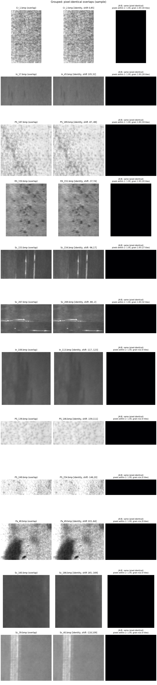 | 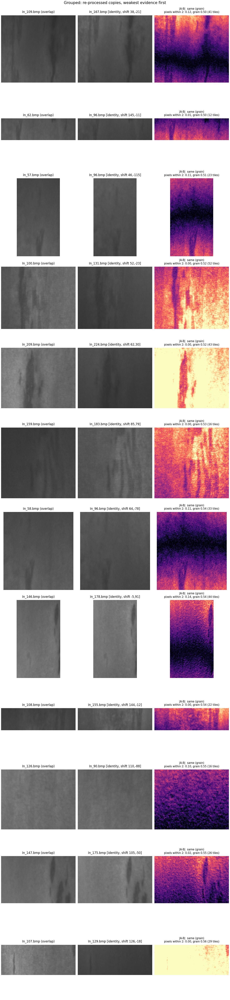 |

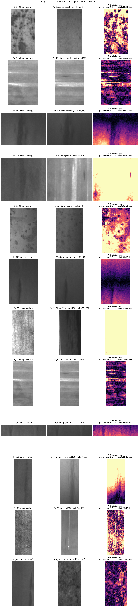

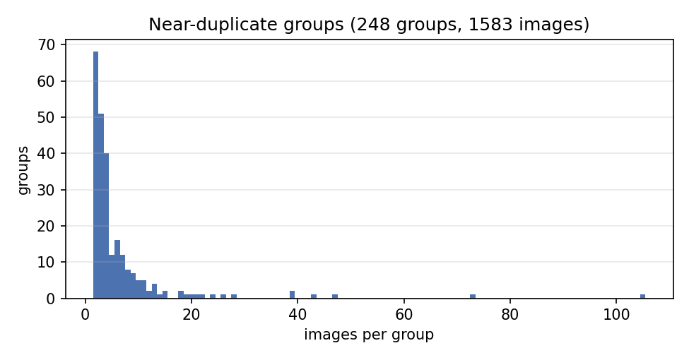

The audit confirms that no group spans two splits, and the classical
cross-validation folds respect the same groups (stratified group k-fold), so
tuning is leakage-free as well.

### Exploratory analysis

The classes differ mainly in local texture and structure, not global
brightness: mean intensity varies widely within each class (a standard
deviation of 49 grey levels for pitted surface), and most images darken
towards the right edge because of uneven illumination, which argues for local
contrast normalization (CLAHE).

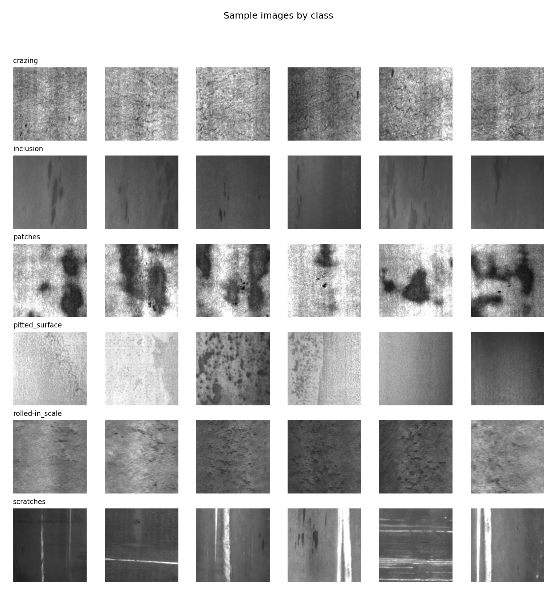

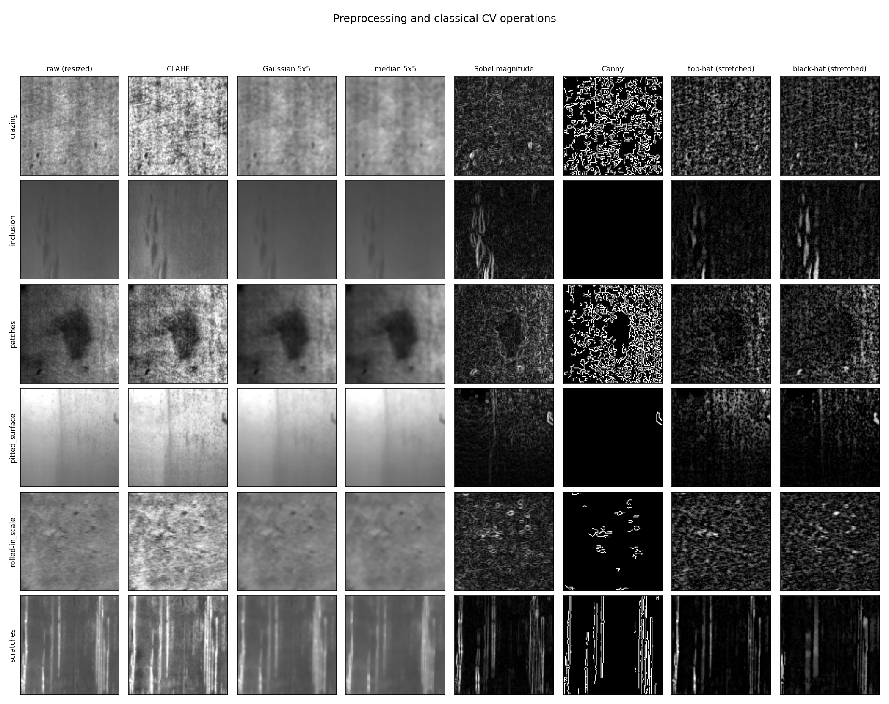

## 3. Features

| Descriptor | Settings | Dimension |
|---|---|---|
| HOG | 9 orientation bins, 16x16 cells, 2x2 blocks, L2-Hys | 1,764 |
| LBP | rotation-invariant uniform codes at (8, 1), (16, 2), (24, 3), normalized histograms | 54 |
| GLCM | 32 grey levels, distances 1, 2, 4, 8, angles 0, 45, 90, 135 degrees; contrast, dissimilarity, homogeneity, energy, ASM, correlation; mean and range over angles | 48 |

All extractors are stateless, so computing them for every image cannot leak
information between splits; standardization is fitted inside each
cross-validation fold.

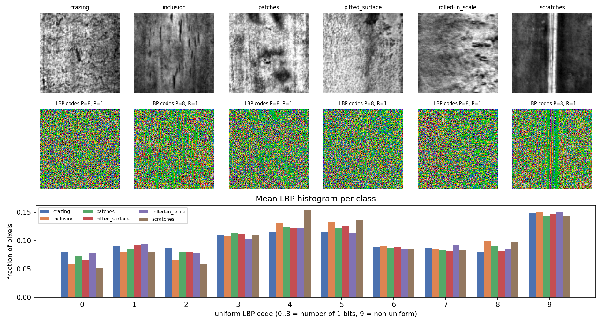

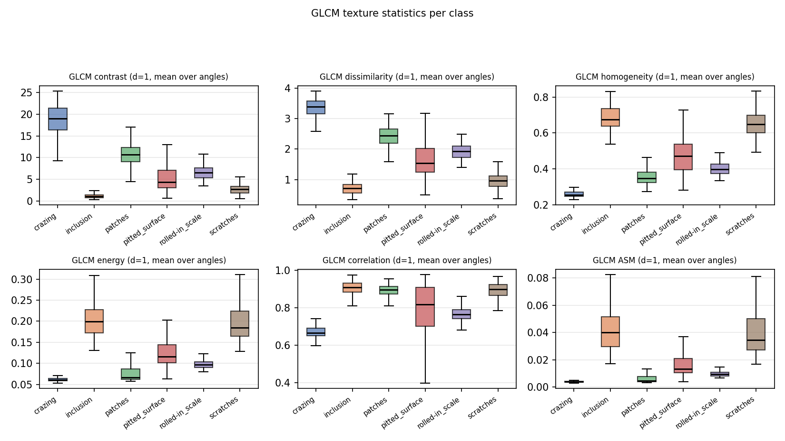

In the t-SNE maps, LBP and GLCM form compact clusters for crazing, patches and
rolled-in scale, while inclusion and scratches overlap: both are elongated
streaks on a smooth background. That overlap is where the classifiers make
most of their mistakes (section 6). HOG mixes crazing, patches and pitted
surface.

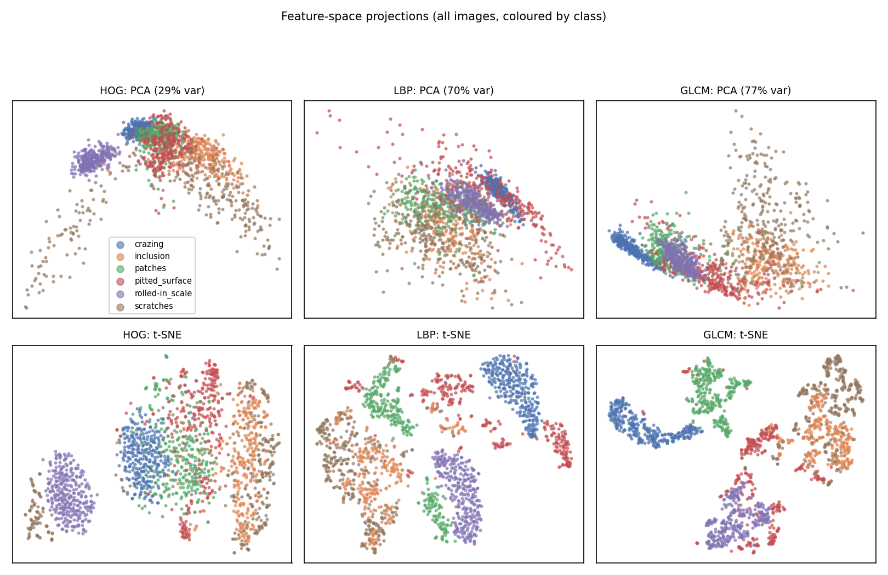

## 4. Classical grid: 5 feature sets x 6 classifiers

Each cell is the mean macro-F1 of grouped 5-fold cross-validation on the
training split, after a grid search over that classifier's hyperparameters
(990 configurations in total, about 22 minutes with all CPU cores and
XGBoost on the GPU). Bold marks the feature set each classifier keeps for its
final model.

| Feature set (dim) | Decision Tree | Logistic Regression | k-NN | SVM | Random Forest | XGBoost |
|---|---|---|---|---|---|---|
| HOG (1,764) | 0.548 | 0.743 | 0.725 | 0.827 | 0.762 | 0.767 |
| LBP (54) | 0.820 | 0.945 | 0.852 | 0.930 | 0.889 | 0.912 |
| GLCM (48) | 0.855 | 0.947 | 0.893 | 0.953 | 0.902 | 0.910 |
| LBP + GLCM (102) | **0.887** | **0.959** | **0.902** | **0.969** | 0.920 | 0.928 |
| HOG + LBP + GLCM (1,866) | 0.867 | 0.892 | 0.863 | 0.907 | **0.923** | **0.928** |

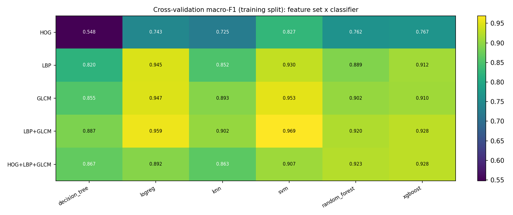

* **Texture beats gradients.** LBP and GLCM alone, with 54 and 48 numbers per
  image, reach about 0.95; HOG tops out at 0.83 with 1,764.
* **LBP and GLCM are complementary.** LBP captures local micro-patterns, GLCM
  grey-level co-occurrence and directionality; together they are best for
  every classifier that is not a tree ensemble.
* **Adding HOG hurts distance- and margin-based models** (SVM 0.969 to 0.907,
  logistic regression 0.959 to 0.892, k-NN 0.902 to 0.863): after
  standardization, 1,764 noisy gradient dimensions dominate distances and
  linear weights. Tree ensembles pick features per split and are unaffected.
* **Selection is honest, not optimal.** Random Forest and XGBoost keep the
  HOG-containing set by a CV margin of 0.003 and 0.0006, far inside the fold
  standard deviation (about 0.03 to 0.04). Their LBP + GLCM variants happen to
  score higher on test (0.963 and 0.966 against 0.907 and 0.945), but choosing
  by test score would be test-set tuning, so the CV choice stands.

## 5. Final models (held-out test split, n = 269)

| Model | Accuracy | Macro F1 | ROC-AUC (OvR) | CV macro-F1 | Test errors | Fit time (s) | Latency (ms/img) |
|---|---|---|---|---|---|---|---|
| LBP + GLCM + Decision Tree | 0.9219 | 0.9216 | 0.9599 | 0.8867 +- 0.0461 | 21 | 0.05 | 9.1 |
| LBP + GLCM + Logistic Regression | 0.9888 | **0.9887** | 0.9997 | 0.9590 +- 0.0245 | 3 | 0.01 | 9.2 |
| LBP + GLCM + k-NN | 0.9405 | 0.9401 | 0.9643 | 0.9023 +- 0.0345 | 16 | 0.00 | 9.4 |
| LBP + GLCM + SVM (RBF) | 0.9851 | 0.9850 | 0.9994 | 0.9695 +- 0.0233 | 4 | 0.04 | 9.2 |
| HOG + LBP + GLCM + Random Forest | 0.9071 | 0.9075 | 0.9947 | 0.9228 +- 0.0386 | 25 | 27.7 | 22.8 |
| HOG + LBP + GLCM + XGBoost | 0.9442 | 0.9451 | 0.9977 | 0.9282 +- 0.0307 | 15 | 4.3 | 14.3 |
| Custom CNN (best-validation seed) | 0.9888 | **0.9888** | 0.9993 | n/a | 3 | 76.6 (GPU) | n/a |

The CNN over five seeds: test macro-F1 **0.9881 +- 0.0055** (range 0.9814 to
0.9963). Latency is single-image, sequential, on the CPU, and includes feature
extraction, which dominates it: every LBP + GLCM model needs about 9 ms
whatever the classifier. A like-for-like latency comparison with the CNN is
part of Phase 3.

Per-class F1:

| Class | DT | LogReg | k-NN | SVM | RF | XGBoost | CNN |
|---|---|---|---|---|---|---|---|
| crazing | 0.989 | 1.000 | 1.000 | 1.000 | 0.989 | 1.000 | 1.000 |
| inclusion | 0.837 | 0.965 | 0.844 | 0.966 | 0.780 | 0.860 | 0.966 |
| patches | 0.956 | 0.978 | 0.989 | 0.989 | 0.977 | 0.989 | 1.000 |
| pitted_surface | 0.905 | 1.000 | 0.945 | 0.978 | 0.894 | 0.930 | 0.977 |
| rolled-in_scale | 0.989 | 1.000 | 0.989 | 1.000 | 1.000 | 1.000 | 1.000 |
| scratches | 0.854 | 0.989 | 0.874 | 0.978 | 0.805 | 0.892 | 0.989 |

| LBP + GLCM + Logistic Regression | Custom CNN |
|---|---|
|  | 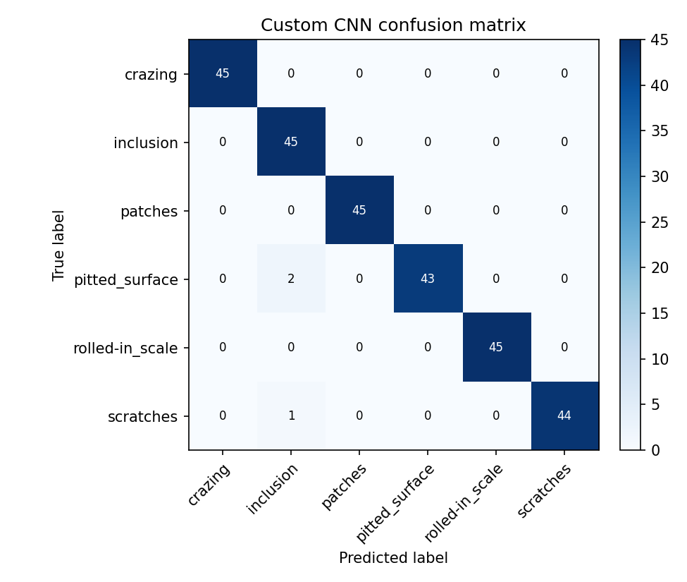 |

* **Features matter more than classifiers.** With LBP + GLCM, a plain
  logistic regression is the best classical model; switching classifier moves
  the score less than switching from HOG to texture features does (HOG + SVM
  scores 0.815 on this split, section 4).
* **The CNN and the best classical model tie.** Both make 3 errors out of 269;
  the difference is far inside the CNN's seed spread (one test image is 0.37
  percentage points).
* **High ROC-AUC with lower accuracy** (Random Forest 0.995 AUC, 0.907
  accuracy) means the ensembles rank the right class highly but their hard
  decisions are biased towards one class (section 6).

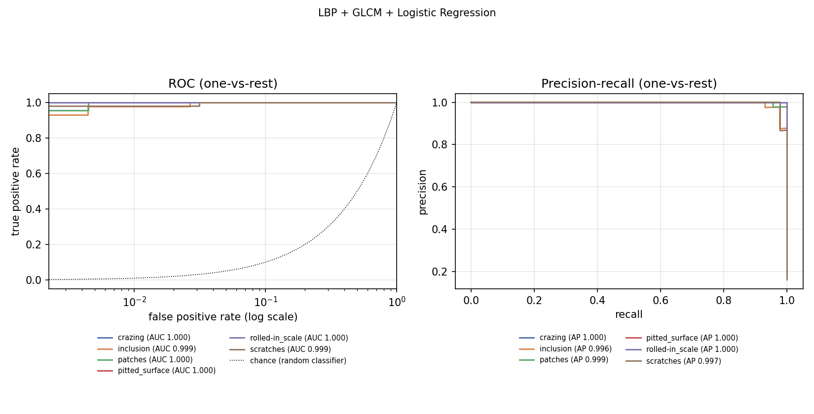

## 6. Error analysis

Inclusion is the catch-all class: of the 87 test errors made by the seven
final models together, 73 have inclusion as the true or the predicted class.

| Model | Most frequent confusions (true as predicted, count) |
|---|---|
| Custom CNN | pitted surface as inclusion (2), scratches as inclusion (1) |
| Logistic Regression | inclusion as patches (2), scratches as inclusion (1) |
| SVM | scratches as inclusion (2), inclusion as pitted surface (1), pitted surface as patches (1) |
| Random Forest | scratches as inclusion (15), inclusion as pitted surface (4), pitted surface as inclusion (3) |
| XGBoost | scratches as inclusion (9), pitted surface as inclusion (5), patches as pitted surface (1) |

* **One image defeats every model.** `Sc_44.bmp` is misclassified as inclusion
  by all seven final models (the CNN with 0.98 confidence). It is a single
  broad, very faint vertical band with soft edges, not the sharp bright line
  of a typical scratch, and looks much like the elongated low-contrast streaks
  of the inclusion class. Beyond it, the CNN and the logistic regression fail
  on different images.
* **The CNN's other errors** are two low-contrast pitted surfaces whose pits
  are small and sparse, again predicted as inclusion.
* **Random Forest misses a third of the scratches** (15 of 46), predicting
  inclusion. The same classifier on LBP + GLCM alone scores 0.963 on test, so
  the HOG dimensions, which make up 95 percent of its 1,866-d input, appear to
  dilute the texture cues that separate a faint streak from a faint inclusion.

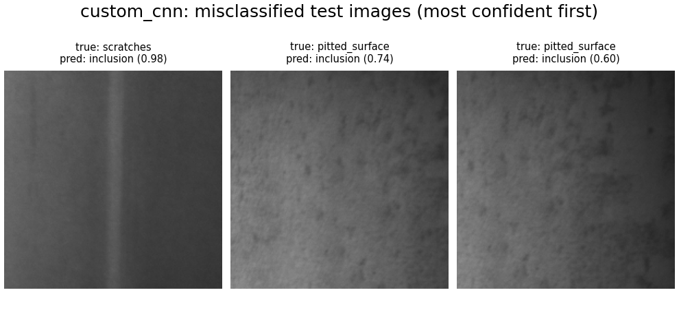

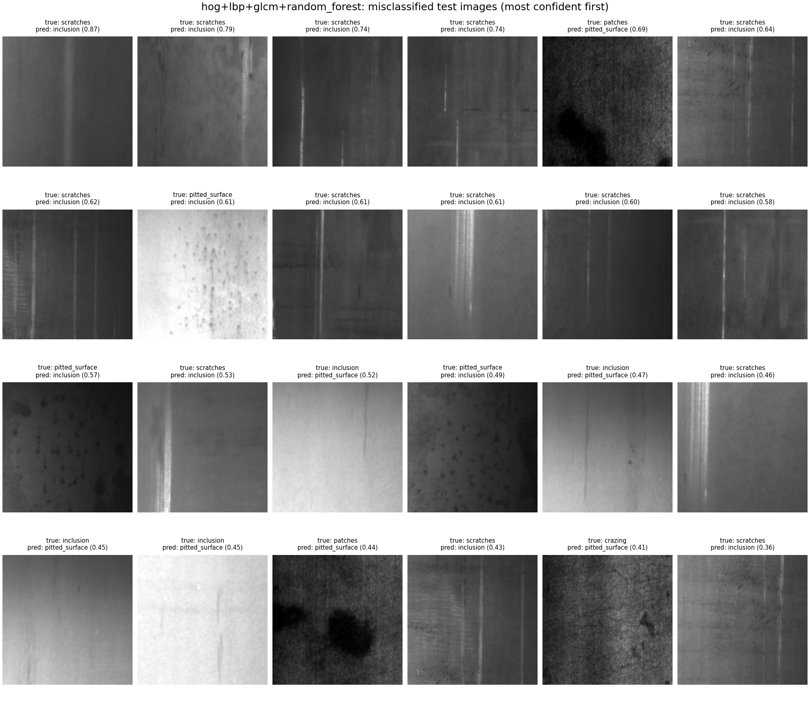

## 7. Why trees overfit, and what ensembles use

On LBP + GLCM, a single tree's training macro-F1 is 0.998 at depth 8 and
exactly 1.0 from depth 15, while cross-validation macro-F1 peaks at 0.862
(depth 8) and settles near 0.85. That gap is the variance of a single tree;
bagging (Random Forest) and boosting (XGBoost) close part of it (0.920 and
0.928 CV on the same features), and a margin-based model on standardized
features closes more (SVM 0.969).

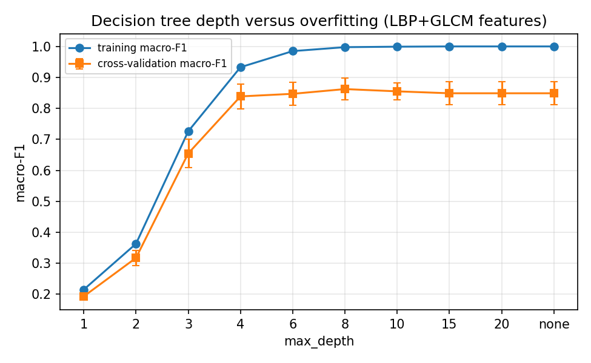

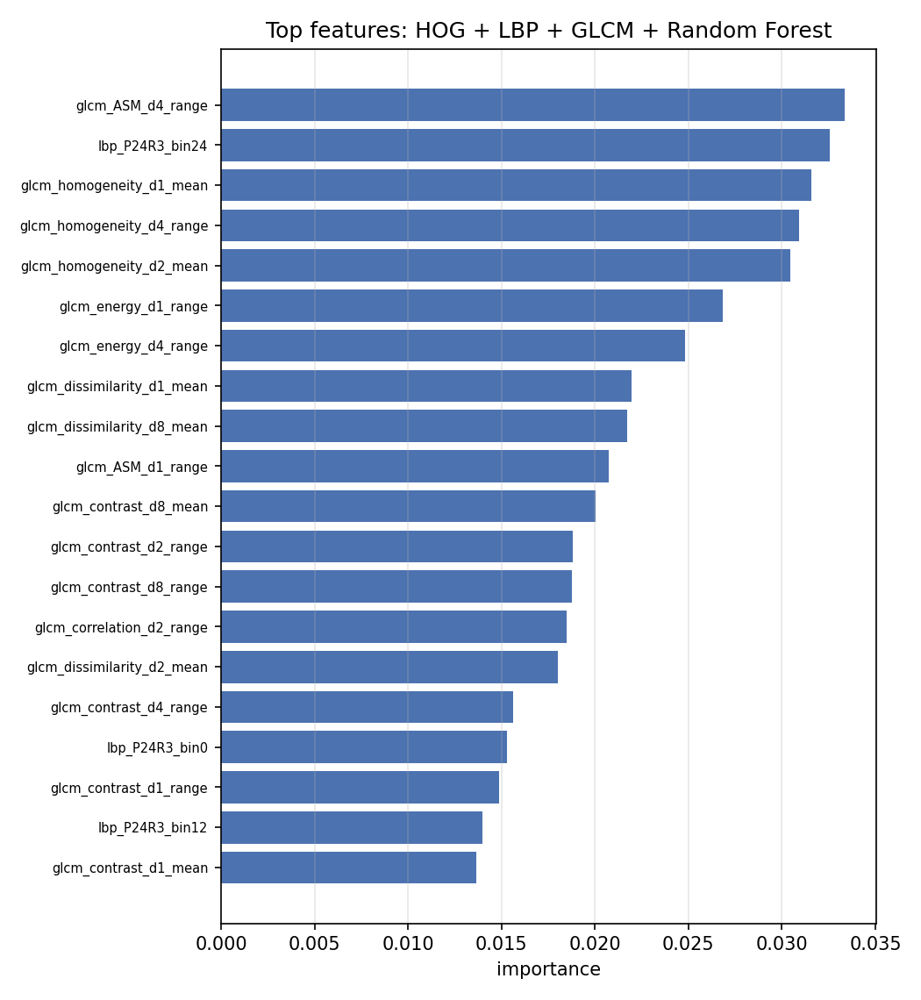

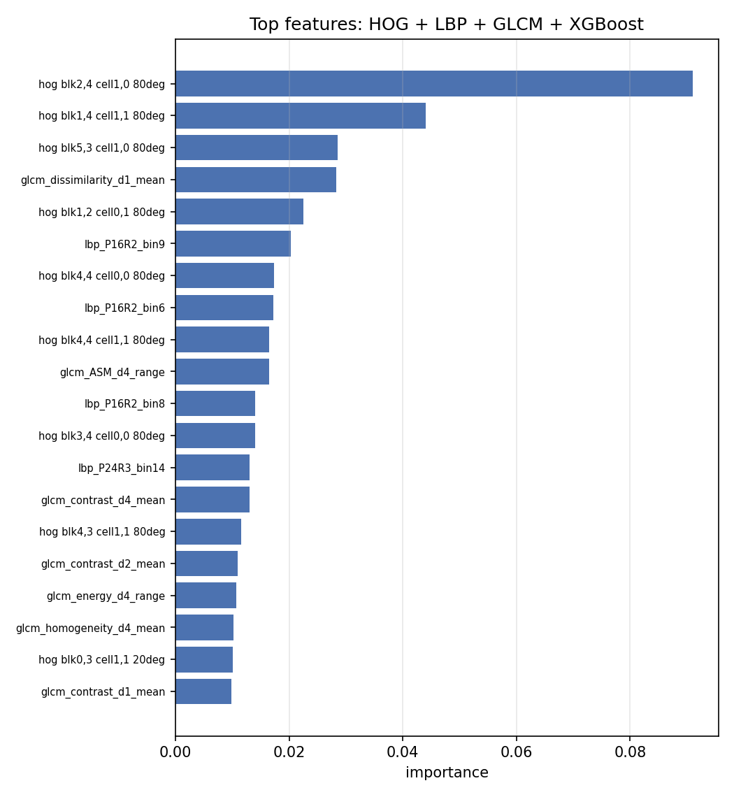

## 8. Ablations (cross-validation on the training split; test not used)

SVM and logistic regression, re-tuned for every variant. Values are CV
macro-F1.

**Preprocessing** (128 px):

| Preprocessing | HOG SVM | LBP SVM | GLCM SVM | LBP + GLCM SVM | LBP + GLCM LogReg |
|---|---|---|---|---|---|
| resize only | 0.867 | 0.936 | **0.960** | 0.962 | 0.955 |
| CLAHE (default) | 0.827 | 0.930 | 0.953 | **0.969** | **0.959** |
| CLAHE + median 3 | 0.823 | 0.907 | 0.944 | 0.940 | 0.933 |
| CLAHE + Gaussian 3 | 0.829 | 0.915 | 0.939 | 0.943 | 0.939 |
| median 3 only | **0.876** | 0.921 | 0.945 | 0.962 | 0.954 |
| CLAHE + Sobel edges | 0.763 | 0.883 | 0.905 | 0.947 | 0.945 |
| CLAHE + top/black-hat | 0.804 | **0.954** | 0.943 | 0.963 | 0.945 |

The last two rows test edge and morphology operations as model input:
"Sobel edges" replaces the image by its Sobel gradient magnitude;
"top/black-hat" is morphological contrast enhancement (image + top-hat -
black-hat, 9x9 elliptical element), which sharpens small bright details such
as inclusions and small dark ones such as pits.

* **Denoising after CLAHE hurts LBP and LBP + GLCM** by 0.015 to 0.051:
  blurring erases the micro-texture LBP measures. GLCM changes by at most
  0.014.
* **CLAHE hurts HOG** (0.040 for SVM, 0.049 for logistic regression) by
  amplifying noise gradients; HOG prefers mild denoising instead.
* **For LBP + GLCM, CLAHE is best**, but within noise of no enhancement at all
  (0.007 and 0.004, against fold standard deviations of 0.02 to 0.04). It is
  kept as the default because it never hurts the chosen features. For LBP or
  GLCM alone, CLAHE changes the score by -0.010 to +0.013 (SVM and logistic
  regression), also within noise.
* **An edge map as input hurts every descriptor and classifier**, by 0.014 to
  0.064 against CLAHE alone: the gradient magnitude discards the intensity
  texture that LBP and GLCM measure, and HOG of an edge map describes
  second derivatives, which are mostly noise.
* **Morphological enhancement helps only LBP with an SVM** (+0.024, the best
  LBP score among the preprocessing variants, but within its fold standard
  deviation of 0.043) and costs 0.006 to 0.024 everywhere else, including
  the final LBP + GLCM features. For HOG it also makes the folds unstable
  (standard deviation 0.083 for the SVM).
* Edge detection and morphology are therefore useful here for *analysis*
  (they show why patches defeat gradient features, notebook 01), not as
  classifier input; neither replaces CLAHE as the default.
* Reproducibility: this ablation was re-run (8 instead of 32 worker
  processes) to add the last two rows. 39 of the 40 earlier rows came out
  identical to every digit; one (HOG + logistic regression after CLAHE +
  Gaussian) moved by 0.0003, a floating-point summation-order effect of the
  different thread layout, with identical validation score and
  hyperparameters.

**Resolution** (CLAHE):

| Size | HOG SVM | LBP LogReg | GLCM SVM | LBP + GLCM SVM | LBP + GLCM LogReg |
|---|---|---|---|---|---|
| 64 px | 0.765 | 0.875 | 0.915 | 0.928 | 0.931 |
| 128 px (default) | 0.827 | 0.945 | 0.953 | **0.969** | 0.959 |
| 200 px (native) | **0.855** | **0.955** | **0.969** | 0.960 | **0.960** |

64 px costs every descriptor 0.03 to 0.09. Single descriptors gain 0.01 to
0.03 at the native 200 px; the LBP + GLCM combination ties between 128 and
200 px, so 128 px stays the default (2.4 times fewer pixels).

**HOG parameters** (SVM, 128 px, CLAHE):

| Variant | Dimension | CV macro-F1 |
|---|---|---|
| cell 8 | 8,100 | 0.769 |
| cell 16 (default) | 1,764 | 0.827 |
| cell 32 | 324 | **0.840** |
| 6 / 12 / 18 orientation bins | 1,176 / 2,352 / 3,528 | 0.823 / 0.825 / 0.815 |
| block 1 (no block normalization) | 576 | 0.723 |
| block 3 | 2,916 | 0.822 |
| L1 / L2 norm instead of L2-Hys | 1,764 | 0.815 / 0.823 |

Block normalization is worth about 0.10; coarser cells help slightly; bins
and norm type barely matter. Even the best HOG variant stays far below the
texture descriptors, so HOG's weakness on NEU is the representation, not its
settings.

| | | |
|---|---|---|
| 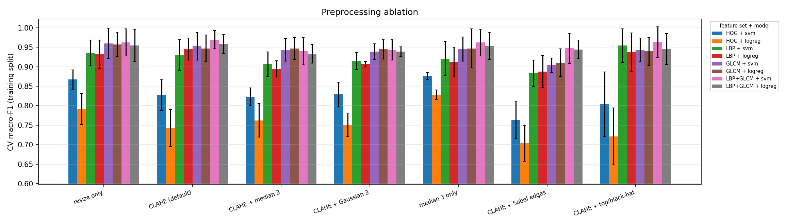 | 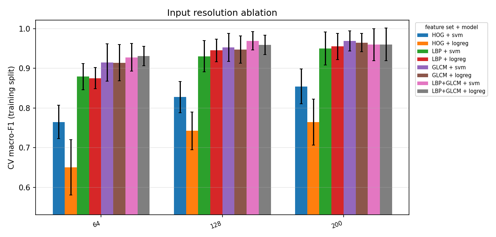 | 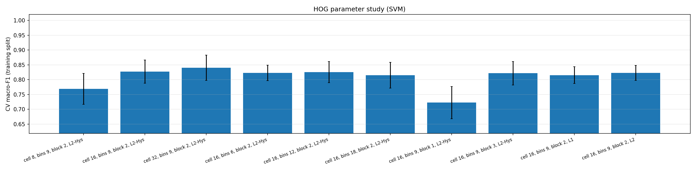 |

## 9. Leakage study: random split versus group-aware split

The same models, trained and tested once on a plain stratified random split
(seed 42, ignoring near-duplicates) and once on the project's group-aware
split. The CNN is the mean of seeds 42 to 44.

| | Random split | Group-aware split |
|---|---|---|
| Test images with a near-duplicate in training | 231 of 270 (85.6 percent) | 0 of 269 |
| Validation images with a near-duplicate in training | 234 of 270 (86.7 percent) | 0 of 271 |

| Model | Random split | Group-aware split | Difference |
|---|---|---|---|
| HOG + SVM | 0.8730 | 0.8147 | +0.058 |
| LBP + GLCM + SVM | 0.9926 | 0.9850 | +0.008 |
| LBP + GLCM + Logistic Regression | 0.9815 | 0.9887 | -0.007 |
| Custom CNN (3 seeds) | 0.9988 +- 0.0021 | 0.9913 +- 0.0043 | +0.008 |

* **HOG is inflated most.** HOG encodes where edges are, so a training crop
  that shares pixels with a test crop is nearly a memorized answer. Global
  texture histograms are affected least.
* **The CNN scores a perfect 1.000 on the random split for two of three
  seeds**, the classic leakage signature.
* The two splits have different test sets, so each difference also contains
  about 0.01 of sampling noise; only the HOG gap is clearly larger than that.
  The point is less the size of the inflation than that, with a random split,
  six of every seven test images are not new.
* The group-aware rows reproduce sections 5 and 10 exactly, which confirms
  that the pipeline is deterministic.

## 10. The custom CNN

| Item | Value |
|---|---|
| Architecture | 3 x (Conv 3x3, BatchNorm, ReLU, MaxPool) with 32 / 64 / 128 channels, global average pooling, dropout 0.3, linear; 93,670 parameters |
| Training | Adam (lr 1e-3, weight decay 1e-4), cosine schedule, batch 64, 150 epochs, random flips and 90-degree rotations |
| Checkpoint | epoch with the best validation macro-F1 |
| Seeds | 42 to 46 on the same split; the reported artifact is the best-validation seed (43) |

**Training length** was chosen on validation data only
(`scripts/cnn_epoch_study.py`, 3 seeds each):

| Epochs | Validation macro-F1 | Time per run (s) |
|---|---|---|
| 40 | 0.9589 +- 0.0023 | 24 |
| 80 | 0.9734 +- 0.0042 | 43 |
| 150 | **0.9794 +- 0.0021** | 76 |

At 40 epochs validation was still rising (one seed peaked at the final
epoch); 150 epochs add 0.02, and their best epochs (66 to 127) fall well
before the end.

**Seeds** (150 epochs):

| Seed | Best epoch | Validation macro-F1 | Test macro-F1 |
|---|---|---|---|
| 42 | 66 | 0.9781 | 0.9888 |
| 43 (kept) | 127 | 0.9818 | 0.9888 |
| 44 | 103 | 0.9782 | 0.9963 |
| 45 | 127 | 0.9782 | 0.9814 |
| 46 | 113 | 0.9782 | 0.9851 |
| mean +- std | | 0.9789 +- 0.0016 | 0.9881 +- 0.0055 |

The kept seed is chosen by validation, not test (seed 44 has the best test
score). Runs are fully deterministic: the epoch study and the seed runs give
identical numbers for the same seed.

Training dynamics: after the first epoch, validation macro-F1 is 0.05 while
training accuracy is already 0.62. That is BatchNorm running
statistics lagging behind the true activation statistics early in training,
not a modelling failure; it resolves within a few epochs.

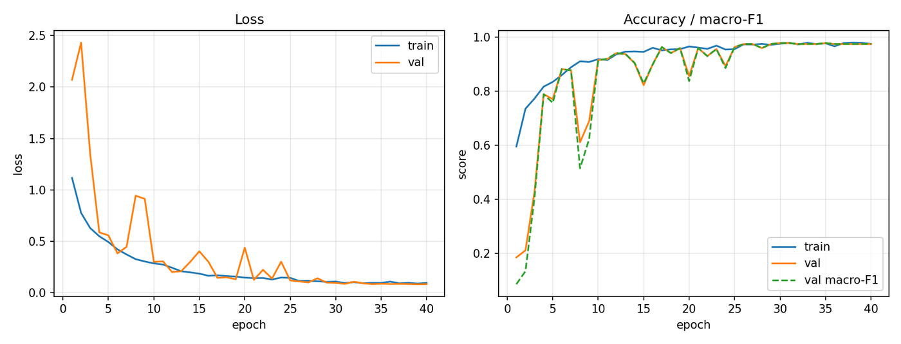

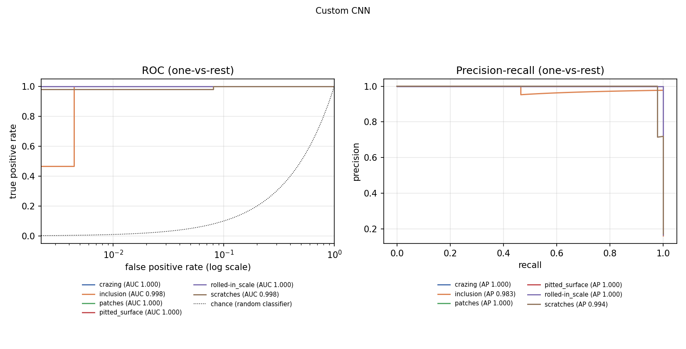

## 11. Cost

| Model | Training | Prediction |
|---|---|---|
| LBP + GLCM + Logistic Regression or SVM | under 0.05 s fit on 1,260 images (CPU) | about 9 ms per image, mostly feature extraction (CPU) |
| HOG + LBP + GLCM + XGBoost | 4.3 s fit (GPU) | 14 ms per image |
| HOG + LBP + GLCM + Random Forest | 27.7 s fit (CPU) | 23 ms per image |
| Custom CNN | 77 s for 150 epochs (GPU) | measured in Phase 3 |

The best classical model is about as accurate as the CNN, fits in a fraction
of a second on a CPU, and consists of 102 interpretable texture statistics
and a linear layer. The CNN's advantage on NEU is not accuracy; Phase 3 tests
whether deeper or pretrained networks change that, and Phase 4 whether either
approach transfers to other surfaces.

## 12. Limitations

* One split. With 269 test images, one image is 0.37 percentage points, so
  differences of one or two images are within noise; the CNN is reported over
  5 seeds, the classical models through their cross-validation spread.
* The near-duplicate detector cannot decide 4,596 low-texture pairs. They are
  kept apart rather than grouped; if some of them are relatives, the reported
  scores are slightly optimistic, never pessimistic.
* Two near-duplicate groups carry both inclusion and scratch labels, and the
  single image every model gets wrong (`Sc_44.bmp`) looks like an inclusion:
  part of the remaining error may be label ambiguity rather than model error.
* NEU images come from one acquisition setup; generalization to other
  surfaces is tested with DAGM in Phase 4.
* All models are closed-set and can be confidently wrong on inputs unlike
  NEU. In the demo, a colour test pattern gets three different labels from
  the seven models, most of them with near-certain confidence, and a nearly
  white image is called inclusion by the CNN. Confidence alone therefore
  cannot flag such inputs; the demo's input checks (colour, brightness and
  contrast outside the training range) do. Probability calibration and an
  explicit "unknown" class are not part of this project.

## 13. Phase 3 setup: one recipe for every CNN

Phase 3 asks what makes a CNN work on NEU: depth, residual links, dense
connectivity, efficient convolutions, or knowledge transferred from ImageNet.
Every network below is trained with the custom CNN's recipe unchanged (same
split, augmentation, Adam with learning rate 1e-3 and weight decay 1e-4,
cosine schedule, 150 epochs, batch 64, checkpoint by validation macro-F1,
full precision) and five seeds (42 to 46). No network got extra tuning, so
differences come from the architecture or the pretraining. ImageNet backbones
see the same 128 px grayscale input, repeated into three channels and
ImageNet-normalized inside the model; unfrozen pretrained layers learn ten
times slower than the new head. Architectures are described in
`docs/methodology.md` (Stage E).

## 14. Architectures trained from scratch (test split, n = 269)

| Model | Parameters | Test macro-F1, 5 seeds | Range | Validation macro-F1 | Time per seed |
|---|---|---|---|---|---|
| Custom CNN | 93,670 | 0.9881 +- 0.0055 | 0.9814 to 0.9963 | 0.9789 +- 0.0016 | 77 s |
| VGG-style | 1,174,182 | **0.9940 +- 0.0033** | 0.9888 to 0.9963 | 0.9912 +- 0.0033 | 194 s |
| ResNet-18 | 2,796,006 | 0.9903 +- 0.0020 | 0.9888 to 0.9925 | 0.9839 +- 0.0032 | 527 s |
| DenseNet-BC | 773,638 | 0.9866 +- 0.0117 | 0.9739 to 0.9963 | 0.9898 +- 0.0031 | 490 s |
| MobileNetV2 | 2,230,982 | 0.9591 +- 0.0156 | 0.9330 to 0.9738 | 0.9737 +- 0.0040 | 128 s |

* **Depth through repetition works; the fancier blocks do not add more.**
  VGG-style is the best scratch network, but the custom CNN, VGG, ResNet-18
  and DenseNet-BC lie within about two test images of each other on average
  (one image is 0.0037 macro-F1), so among them only MobileNetV2 is clearly
  worse.
* **MobileNetV2 from scratch is the weakest and least stable** (seed spread
  0.0156, worst seed 0.9330). The architecture is not the problem: with
  ImageNet weights the same network reaches 0.9970 (section 15). Its 2.2 M
  parameters are hard to fit from 1,260 images alone.
* **DenseNet-BC is the least stable of the rest**: its seeds range from
  0.9739 to 0.9963.
* Every scratch CNN, in every seed, misclassifies `Sc_44.bmp` (0 of 25 runs
  get it right), the faint scratch every classical model also calls
  inclusion.

## 15. Transfer learning from ImageNet (test split, n = 269)

| Backbone | Fine-tuning | Trained / total parameters | Test macro-F1, 5 seeds | Range | Validation macro-F1 | Time per seed |
|---|---|---|---|---|---|---|
| ResNet-18 | frozen | 3,078 / 11,179,590 | 0.9630 +- 0.0031 | 0.9587 to 0.9661 | 0.9679 +- 0.0020 | 52 s |
| ResNet-18 | partial | 8,396,806 / 11,179,590 | 0.9940 +- 0.0033 | 0.9888 to 0.9963 | 0.9993 +- 0.0017 | 64 s |
| ResNet-18 | full | 11,179,590 | 0.9978 +- 0.0020 | 0.9963 to 1.0000 | 1.0000 +- 0.0000 | 112 s |
| DenseNet-121 | frozen | 6,150 / 6,960,006 | 0.9764 +- 0.0041 | 0.9696 to 0.9809 | 0.9896 +- 0.0017 | 148 s |
| DenseNet-121 | partial | 2,166,278 / 6,960,006 | 0.9962 +- 0.0065 | 0.9849 to 1.0000 | 0.9963 +- 0.0000 | 168 s |
| DenseNet-121 | full | 6,960,006 | **1.0000 +- 0.0000** | 1.0000 to 1.0000 | 1.0000 +- 0.0000 | 355 s |
| MobileNetV2 | frozen | 7,686 / 2,231,558 | 0.9794 +- 0.0060 | 0.9730 to 0.9849 | 0.9762 +- 0.0019 | 46 s |
| MobileNetV2 | partial | 1,689,030 / 2,231,558 | 0.9970 +- 0.0017 | 0.9962 to 1.0000 | 1.0000 +- 0.0000 | 59 s |
| MobileNetV2 | full | 2,231,558 | 0.9940 +- 0.0043 | 0.9887 to 1.0000 | 1.0000 +- 0.0000 | 123 s |

* **Pretraining is the largest single gain of the project.** Fully
  fine-tuned DenseNet-121 classifies all 269 test images correctly in all
  five seeds, and its validation macro-F1 is 1.0000 in every seed too; the
  checkpoint and the seed were chosen on validation, never on test. The
  split is the group-aware one (no test image shares a near-duplicate group
  with a training image), so this is not leakage. Fully fine-tuned ResNet-18
  (0.9978) and partially fine-tuned MobileNetV2 (0.9970) are within one test
  image of it.
* **Frozen ImageNet features are not enough.** A linear head on fixed
  features reaches only 0.963 to 0.979, below every scratch CNN except
  MobileNetV2: natural-image features describe steel texture poorly until
  they are adapted.
* **How much to unfreeze depends on the backbone.** ResNet-18 and DenseNet-121
  improve at each step (frozen, partial, full). MobileNetV2 is best partially
  fine-tuned (0.9970); full fine-tuning is lower (0.9940) and less stable,
  within about one standard deviation, so the two are a tie rather than a
  reversal.
* **Pretraining makes MobileNetV2 viable**: from 0.9591 +- 0.0156 from
  scratch to 0.9970 +- 0.0017 partially fine-tuned.
* **Pretrained models solve the image no NEU-only model can.** `Sc_44.bmp` is
  classified correctly in 33 of the 45 ImageNet runs (every seed of
  ResNet-18 partial, DenseNet-121 partial and full, and MobileNetV2 frozen
  and partial), and in none of the 25 scratch-CNN runs. ResNet-18 frozen
  never gets it right; ResNet-18 full does in 3 of 5 seeds and MobileNetV2
  full in 1.
* **Validation saturates.** Several transfer models reach 1.0000 validation
  macro-F1 in every seed, so the validation split can no longer rank them;
  the test split separates them by one or two images, which is within noise.

| DenseNet-121 (ImageNet, full) | ResNet-18 (ImageNet, full) |
|---|---|
| 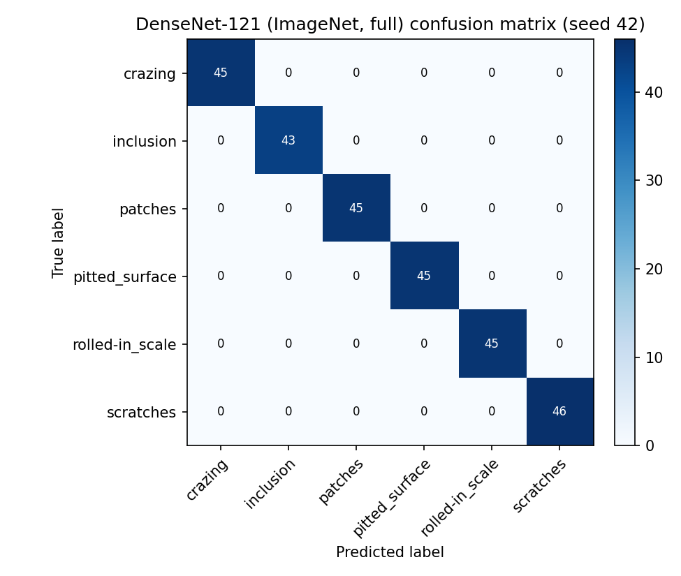 |  |

## 16. Where the CNNs look (Grad-CAM)

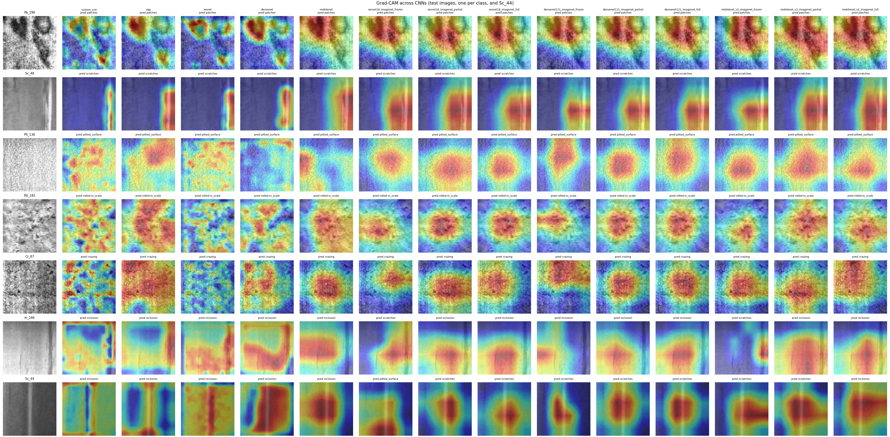

* **The scratch CNNs with fine final maps trace the defect**: the thin
  scratch line, the edges of dark patches, the crazing network. Their last
  feature maps are 16x16 (custom CNN, ResNet-18, DenseNet-BC) or 8x8 (VGG)
  cells at 128 px input.
* **Networks that downsample 32 times produce coarse blobs**: the ImageNet
  backbones and the scratch MobileNetV2 end in a 4x4 map at 128 px, so they
  localize regions, not lines, even when they classify better. Grad-CAM shows
  where evidence was found, not how fine the model's internal reasoning is.
* **Grad-CAM does not explain `Sc_44.bmp`.** Its faint band covers 4 pixel
  columns (3 percent of the image); every model puts 2 to 6 percent of its
  Grad-CAM mass there (2.4 to 5.4 percent for those that predict inclusion,
  4.3 to 6.1 percent for those that predict scratches), so the maps cannot
  tell the right models from the wrong ones at this scale.
* The per-model galleries are in `experiments/figures/cnn/gradcam_<model>.png`
  (correct test images per class first, the model's errors last).

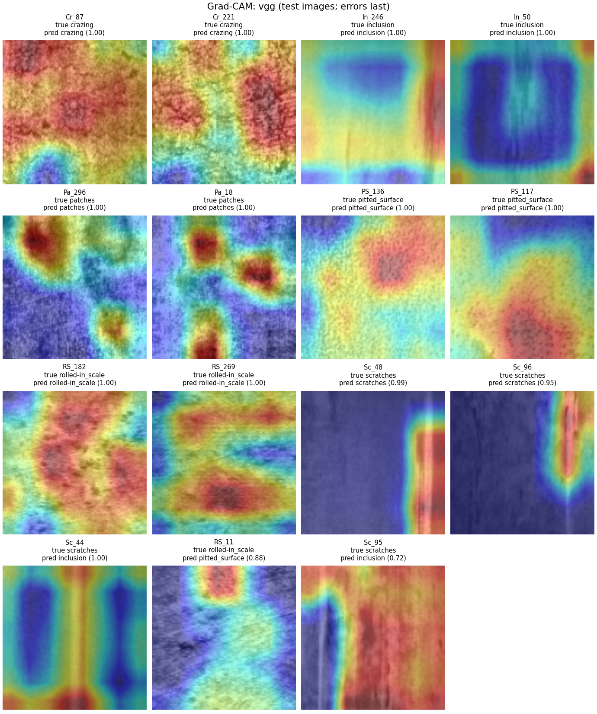

## 17. Efficiency (laptop: RTX 5070 Laptop GPU, 16-thread CPU)

Single-image latency excludes preprocessing (resize and CLAHE: 0.16 ms per
image, identical for every model). Batch-1 timings drift by tens of percent
over minutes, so they were measured in five interleaved rounds; the table
gives the median and the range over rounds. Batch-64 throughput is stable to
within a few percent. Frozen, partial and full variants of one backbone are
the same network at inference, so their spread is measurement noise.

| Model | Parameters | Size on disk | CPU latency | GPU latency | GPU throughput | GPU memory, one training step | Test macro-F1 |
|---|---|---|---|---|---|---|---|
| Custom CNN | 93,670 | 0.37 MB | 1.3 ms (1.3 to 1.4) | 0.5 ms | 9,909 img/s | 688 MB | 0.9881 |
| VGG-style | 1,174,182 | 4.50 MB | 3.8 ms (3.6 to 3.9) | 0.9 ms | 3,574 img/s | 1,212 MB | 0.9940 |
| ResNet-18 (scratch) | 2,796,006 | 10.72 MB | 9.0 ms (8.5 to 9.2) | 2.2 ms | 1,272 img/s | 2,388 MB | 0.9903 |
| DenseNet-BC (scratch) | 773,638 | 3.17 MB | 15.5 ms (12.6 to 16.4) | 5.0 ms | 1,078 img/s | 4,456 MB | 0.9866 |
| MobileNetV2 (scratch) | 2,230,982 | 8.74 MB | 7.4 ms (7.3 to 7.5) | 2.6 ms | 6,569 img/s | 1,648 MB | 0.9591 |
| ResNet-18 (ImageNet, full) | 11,179,590 | 42.73 MB | 6.8 ms (5.5 to 7.5) | 2.5 ms | 5,528 img/s | 501 MB | 0.9978 |
| DenseNet-121 (ImageNet, full) | 6,960,006 | 27.15 MB | 22.1 ms (16.2 to 22.5) | 13.0 ms | 1,663 img/s | 2,647 MB | 1.0000 |
| MobileNetV2 (ImageNet, partial) | 2,231,558 | 8.76 MB | 7.5 ms (7.4 to 7.7) | 2.7 ms | 6,691 img/s | 220 MB | 0.9970 |
| LBP + GLCM + Logistic Regression | 102 features | 0.01 MB | 9.0 ms (8.9 to 9.2) | n/a | 111 img/s (CPU) | n/a | 0.9887 |

The full table for all 20 models is in `experiments/results/efficiency.json`.

* **The custom CNN is the cheapest model by every measure** (1.3 ms on a
  CPU, 0.37 MB) and only about two test images behind the best.
* **The classical model is not cheaper.** Its 9 ms are almost all LBP and
  GLCM feature extraction on the CPU; the logistic regression itself costs
  microseconds. The custom CNN is about 7 times faster on the CPU and the
  VGG-style CNN about 2 times.
* **Accuracy against cost.** Partially fine-tuned MobileNetV2 (0.9970 at
  7.5 ms CPU, 8.8 MB) and fully fine-tuned ResNet-18 (0.9978 at 6.8 ms CPU)
  are within one test image of the perfect DenseNet-121 at about a third of
  its CPU latency. DenseNet-121's 121 layers make it the slowest CNN at batch
  size 1, on the GPU too, where per-layer launch overhead dominates.
* **ImageNet backbones train faster than the scratch networks**: ResNet-18
  (ImageNet, full) needs 112 s per seed against 527 s for the scratch
  ResNet-18, because torchvision's stem shrinks the image four times before
  the first residual stage, while the scratch version keeps 128 px for fine
  texture.
* Frozen and partial models need little memory to train (no gradients flow
  through the frozen layers), which matters on small GPUs.

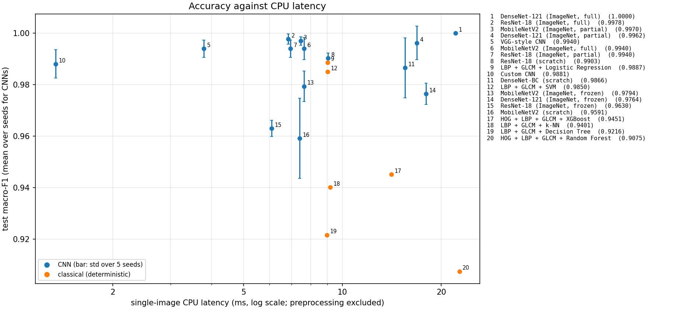

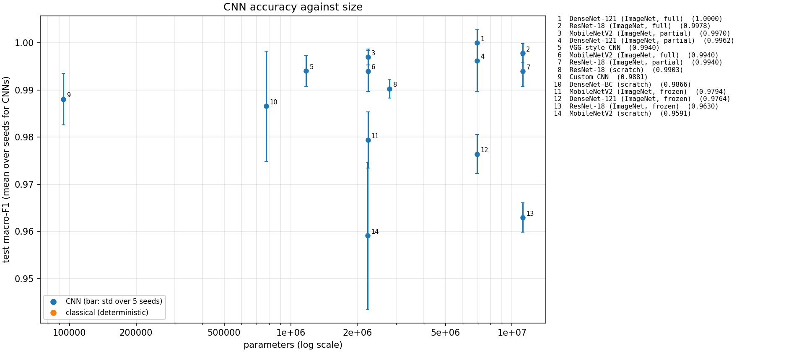

## 18. Sensitivity studies and data requirement (validation split only)

Three models were studied: the custom CNN (baseline), the VGG-style CNN (best
scratch model by validation) and ResNet-18 (ImageNet, full). ResNet-18 and
DenseNet-121 (both full) tie at validation macro-F1 1.0000; ResNet-18 was
taken because it trains three times faster. Three seeds each; the test split
is never used.

**Input resolution and CLAHE** (validation macro-F1):

| Model | 64 px | 128 px | 200 px | no CLAHE | CLAHE |
|---|---|---|---|---|---|
| Custom CNN | **0.9878 +- 0.0021** | 0.9794 +- 0.0021 | 0.9721 +- 0.0019 | 0.9805 +- 0.0020 | 0.9794 +- 0.0021 |
| VGG-style | 0.9963 +- 0.0064 | 0.9927 +- 0.0000 | 0.9927 +- 0.0000 | 0.9915 +- 0.0021 | 0.9927 +- 0.0000 |
| ResNet-18 (ImageNet, full) | 1.0000 | 1.0000 | 1.0000 | 1.0000 | 1.0000 |

* **The custom CNN gets worse as the resolution grows** (0.9878, 0.9794,
  0.9721), each step about four seed standard deviations. Its receptive field
  is only about 22 pixels; at a smaller input each unit sees a larger part of
  a defect. Its 128 px default was never tuned for it; the main runs keep it,
  so this is reported as a finding rather than used to change results after
  the fact.
* **VGG is flat**, and ResNet-18 (ImageNet) is perfect at every size: the
  validation split cannot rank its settings.
* **CLAHE does not matter for CNNs** (differences of at most 0.0012, inside
  the seed spread). Together with Phase 2: CLAHE is within noise for texture
  features, hurts HOG, and is unnecessary for CNNs, which learn their own
  contrast normalization.

**Data requirement** (validation macro-F1, mean +- std over 3 seeds; training
subsets are class-stratified and drawn from the training split only):

| Model | 10 % (126 images) | 25 % (313) | 50 % (630) | 100 % (1,260) |
|---|---|---|---|---|
| ResNet-18 (ImageNet, full) | **0.9815 +- 0.0148** | **0.9951 +- 0.0057** | **0.9988 +- 0.0021** | **1.0000** |
| VGG-style | 0.9427 +- 0.0289 | 0.9684 +- 0.0105 | 0.9842 +- 0.0021 | 0.9927 |
| Custom CNN | 0.9118 +- 0.0507 | 0.9538 +- 0.0141 | 0.9637 +- 0.0108 | 0.9794 +- 0.0021 |
| LBP + GLCM + LogReg | 0.9227 +- 0.0280 | 0.9155 +- 0.0224 | 0.9242 +- 0.0300 | 0.9449 |
| LBP + GLCM + SVM | 0.8710 +- 0.0689 | 0.9218 +- 0.0197 | 0.9169 +- 0.0212 | 0.9340 |

* **"Handcrafted features need less data" does not hold here.** With 126
  images the texture classifier only ties the small custom CNN (0.9227
  against 0.9118 +- 0.0507) and already trails VGG; from 313 images on every
  CNN is ahead.
* **The pretrained CNN is the data-efficient choice**: trained on 126 images
  it already matches the custom CNN trained on all 1,260 (0.9815 against
  0.9794), and with 313 it is above every scratch CNN at any size.
* **Texture classifiers hardly improve with more data** (logistic regression
  from 0.92 to 0.94): they are limited by what LBP and GLCM can describe, not
  by sample size.
* The SVM is the noisiest with little data: its grid search over C and gamma
  is chosen from 5-fold scores on a few hundred images.

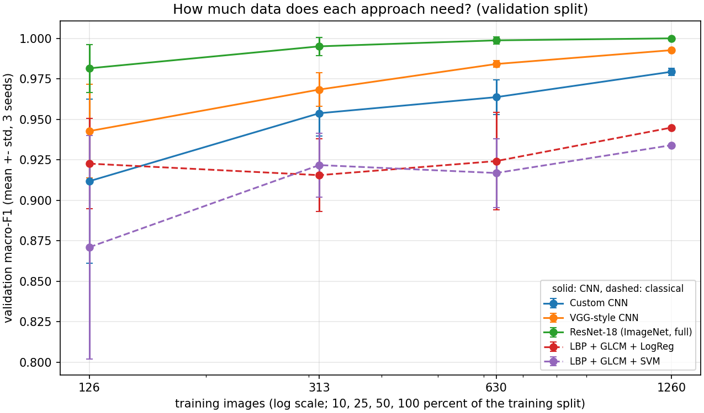

| Resolution | CLAHE |
|---|---|
| 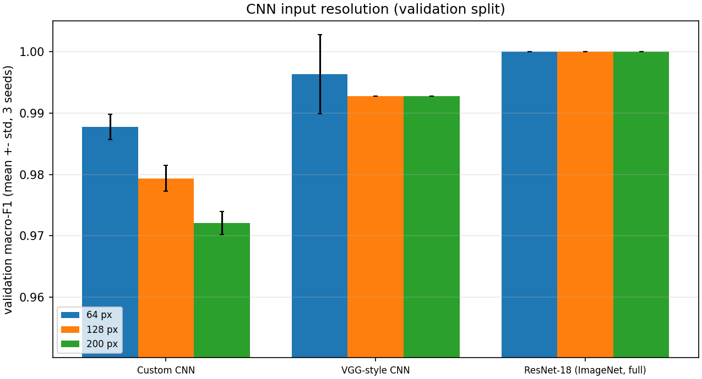 | 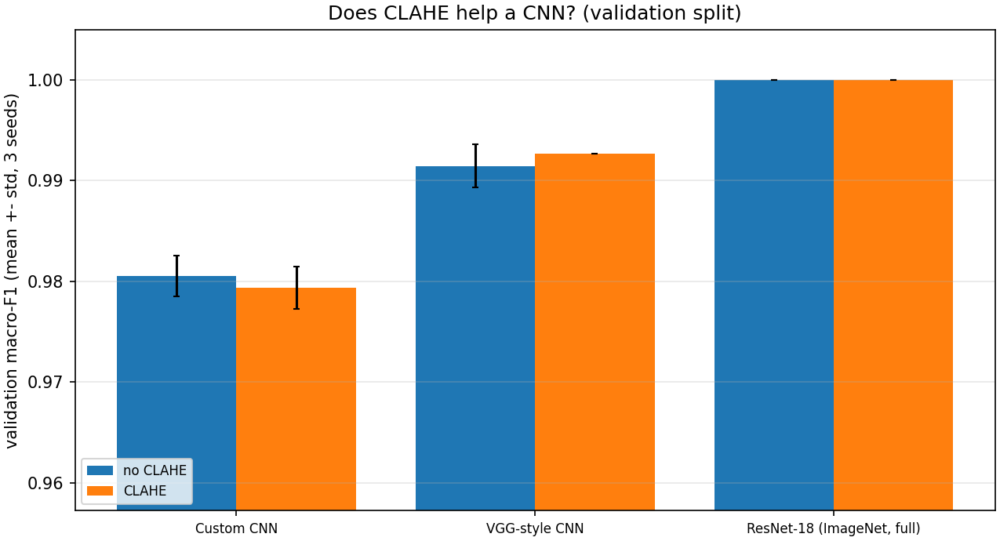 |

## 19. Classical versus CNN: conclusion

| Question | Classical (LBP + GLCM + logistic regression) | CNN |
|---|---|---|
| Accuracy (test macro-F1) | 0.9887 | 0.9881 (custom CNN) to 1.0000 (DenseNet-121, ImageNet, full) |
| Data needed | plateaus early, about 0.92 to 0.94 on validation from 126 to 1,260 images | keeps improving; pretrained: 0.98 with 126 images |
| Training cost | 0.01 s fit and a 0.1 s grouped CV search on a CPU, after feature extraction | 46 s to 9 min per seed on a laptop GPU |
| Inference (CPU, one image) | 9 ms, almost all feature extraction | 1.3 ms (custom CNN) to 22 ms (DenseNet-121) |
| Interpretability | 102 named texture statistics, linear weights | Grad-CAM maps; fine-grained for scratch CNNs, coarse for ImageNet backbones |
| Deployment | scikit-learn, no GPU, 10 KB model | PyTorch; 0.4 to 43 MB; GPU optional |
| Failure mode | inclusion versus faint scratches | same for NEU-only CNNs; ImageNet fine-tuning mostly resolves it |

On NEU with a leakage-free split:

1. **Well-chosen handcrafted features are a strong baseline.** LBP + GLCM with
   a linear model ties a small CNN trained from scratch, is fully
   interpretable and needs no GPU.
2. **A CNN from scratch is not automatically better**: four of five
   architectures land within about two test images of the texture model.
3. **Transfer learning is what moves the result**: partial or full ImageNet
   fine-tuning reaches 0.994 to 1.000, needs a tenth of the data for 0.98, and
   is the only approach that classifies `Sc_44.bmp` correctly.
4. **For deployment on a CPU**, the custom CNN (1.3 ms, 0.4 MB) or partially
   fine-tuned MobileNetV2 (7.5 ms, 0.997) are the sensible choices; the
   perfect DenseNet-121 costs about three times MobileNetV2's latency for at
   most one more correct test image.

## 20. Phase 3 limitations

* NEU is close to saturated for pretrained CNNs: with 269 test images, one
  image is 0.0037 macro-F1, and several models are within one image of each
  other. Their ranking is not meaningful beyond "near perfect"; harder data
  (DAGM, KolektorSDD) is the subject of Phase 4.
* Every CNN used one shared recipe; per-architecture tuning could change the
  scratch ranking slightly (for example the custom CNN prefers 64 px).
* ImageNet backbones were fine-tuned at 128 px, below their 224 px training
  resolution; larger inputs could sharpen their Grad-CAM maps.
* Latency was measured on one laptop with other software running; batch-1
  timings vary by up to about 40 percent between rounds, which the reported
  ranges show.
