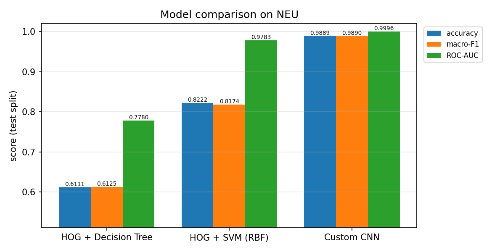
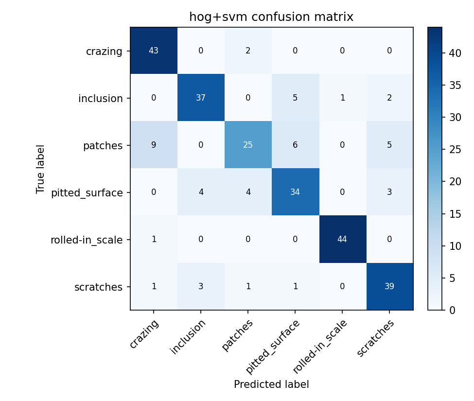
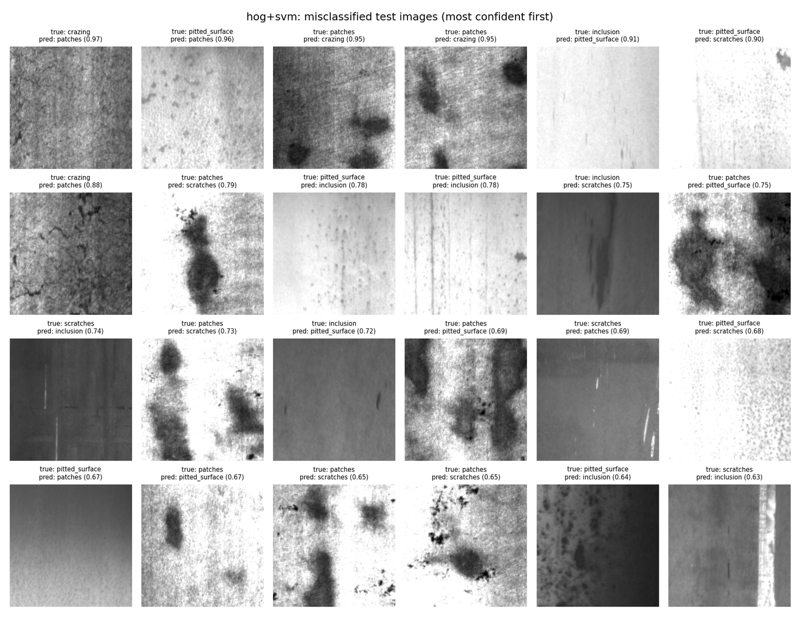

# Experiments and results

This document records what was run, how, and what the results mean. Every
number here is produced by the scripts in `scripts/` and can be regenerated
with `bash scripts/run_baseline.sh`; the raw metrics live in
`experiments/results/*.json` and the run log in `experiments/logs/runs.csv`.

## 1. Setup

| Item | Value |
|---|---|
| Dataset | NEU-CLS, 1,800 grayscale 200x200 images, 6 classes x 300 |
| Split | 70 / 15 / 15 stratified (1,260 / 270 / 270), seed 42, duplicate-aware |
| Input | resized to 128x128, CLAHE (clip 2.0, 8x8 tiles), scaled to [0, 1], no denoising |
| Model selection | validation split only; the test split is evaluated once per model |
| Hardware | AMD Ryzen 9 8940HX, NVIDIA RTX 5070 Laptop GPU, WSL 2 |
| Software | Python 3.12, PyTorch 2.12 (CUDA 12.8), scikit-learn 1.8, scikit-image 0.26, OpenCV 4.12 |
| Config | `configs/neu_baseline.yaml` (its hash is stored in every metrics file) |

## 2. Dataset audit

`scripts/dataset_report.py` checks every image before training:

* all 1,800 files are readable, 200x200, single-channel `uint8`;
* classes are perfectly balanced (300 each; 210 / 45 / 45 per split);
* **one exact duplicate pair exists: `Pa_101.bmp` and `Pa_105.bmp`** (identical
  pixels). A naive random split can put one copy in training and the other in
  test, which silently inflates test scores. The split therefore treats each
  duplicate group as a single unit, and the audit verifies that no group spans
  two splits.

Exploratory analysis (`notebooks/01_dataset_exploration.ipynb`) shows that the
classes differ mainly in local texture and structure rather than global
brightness: mean intensity varies widely *within* each class (for example about
49 grey levels for pitted surface), and most images darken towards the right
edge because of uneven illumination, which argues for local contrast
normalisation (CLAHE).

## 3. Baseline models

| Model | Representation | Classifier | Key settings |
|---|---|---|---|
| HOG + Decision Tree | HOG, 9 bins, 16x16 cells, 2x2 blocks, L2-Hys (1,764-d) | CART | Gini, max depth 20, min 2 samples per leaf |
| HOG + SVM | same HOG vector, standardized | SVC, RBF kernel | C = 10, gamma = "scale", Platt-scaled probabilities |
| Custom CNN | learned from pixels | 3 x (Conv 3x3, BN, ReLU, MaxPool) with 32/64/128 channels, global average pooling, dropout 0.3, linear | Adam (lr 1e-3, weight decay 1e-4), cosine schedule, batch 64, 40 epochs, flips + 90-degree rotations |

The CNN checkpoint is the epoch with the best **validation** macro-F1 (epoch 35
of 40).

## 4. Results (held-out test split, n = 270)

| Model | Accuracy | Macro P | Macro R | Macro F1 | ROC-AUC (OvR) | Train time (s) | Size |
|---|---|---|---|---|---|---|---|
| HOG + Decision Tree | 0.6111 | 0.6188 | 0.6111 | 0.6125 | 0.7780 | 1.3 | 1,764-d features |
| HOG + SVM (RBF) | 0.8222 | 0.8219 | 0.8222 | 0.8174 | 0.9783 | 1.8 | 1,764-d features |
| Custom CNN | 0.9889 | 0.9896 | 0.9889 | 0.9890 | 0.9996 | 20.2 | 93,670 parameters |

Per-class F1:

| Class | HOG + Decision Tree | HOG + SVM (RBF) | Custom CNN |
|---|---|---|---|
| crazing | 0.5895 | 0.8687 | 1.0000 |
| inclusion | 0.6747 | 0.8315 | 0.9677 |
| patches | 0.4646 | 0.6494 | 1.0000 |
| pitted_surface | 0.4819 | 0.7473 | 0.9773 |
| rolled-in_scale | 0.7826 | 0.9778 | 1.0000 |
| scratches | 0.6818 | 0.8298 | 0.9888 |

| HOG + SVM | Custom CNN |
|---|---|
|  |  |

## 5. Analysis

### Decision Tree versus SVM on the same features

Both classifiers see identical HOG vectors, yet the SVM is 0.20 macro-F1 ahead.
A decision tree splits on one feature at a time; with 1,764 correlated gradient
bins and only 1,260 training images, a depth-20 tree memorizes idiosyncratic
thresholds (high variance). The RBF-SVM instead finds a maximum-margin boundary
in a kernel space on standardized features, using all bins at once. The SVM's
ROC-AUC (0.978) is much higher than its accuracy suggests: it ranks the correct
class highly even when the top-1 decision is wrong, so a better feature space
should convert directly into accuracy. Ensembles (Random Forest, XGBoost) are
the natural next test of the variance argument.

### Where gradient features fail

The classical branch's weakest classes are **patches** and **pitted surface**.
The most frequent HOG + SVM confusions are patches predicted as crazing (9),
pitted surface (6) and scratches (5); the decision tree's most frequent is
pitted surface predicted as patches (14). Patches are large, soft, dark blobs:
their boundaries produce weak, diffuse gradients, while the grainy background
produces strong random ones (visible in the Sobel and Canny columns above). HOG
summarizes orientation statistics, not intensity texture, so these classes look
alike to it. Classes defined by strong oriented edges are handled well
(rolled-in scale 0.98, crazing 0.87). This is the question Phase 2 tests with
LBP and GLCM texture descriptors.

### The CNN

The CNN learns texture and shape filters jointly and reaches 0.989 macro-F1.
Its three remaining errors are faint, sparse defects: two low-contrast pitted
surfaces and one faint scratch, all predicted as inclusion, the class
characterized by small, isolated, low-contrast marks.

Training dynamics: validation macro-F1 is near chance in the first epochs
(0.09 at epoch 1) even though training accuracy is already 60 percent. This is
BatchNorm running statistics lagging behind the true activation statistics
early in training, not a modelling failure; it resolves within a few epochs.
With 20 epochs the best validation epoch was the last one (still improving), so
the schedule was extended to 40 epochs, which raised validation macro-F1 from
0.956 to 0.978. This choice was made on validation data only.

### Cost

The classical models train in about 2 seconds on a CPU and the HOG + SVM
predicts the whole test split in 0.12 s; the CNN needs a GPU for comfortable
training (20 s) but is still tiny (94k parameters). A full efficiency comparison
(latency, throughput, memory, model size) is part of Phase 3.

## 6. Limitations

* Single seed and a single split; with 270 test images one image is 0.37
  percentage points, so differences of one or two images are within noise.
  Multi-seed means and standard deviations come with Phase 3.
* Classical hyperparameters are untuned defaults; tuning on the validation split
  is part of Phase 2, so the classical numbers are a lower bound.
* NEU images are captured under one setup; generalization to other surfaces is
  tested with DAGM in Phase 4.
